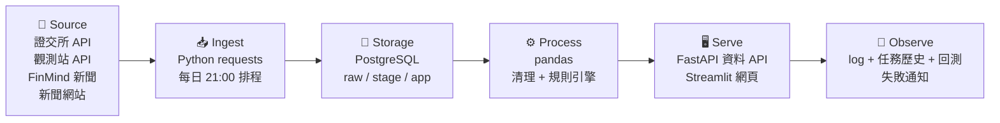

# 注意股，還差幾步？

> 一句話描述：為收盤後才看盤的短線、融資散戶，解決「自選股被列注意後，還差幾次會被處置、哪天開始受限」查不到的問題。

TibaMe 資料工程專題（NKR204），個人製作。2026/11 起實作，預計 12 月底 Demo。

---

## 為什麼做這個

台股有一套「注意 → 處置」制度：證交所每個交易日收盤後公布注意股，第 1–8 款的注意次數會累計，達到門檻（連 3 日、連 5 日、10 日內 6 次、30 日內 12 次）就成為**處置股**——撮合變慢、大額委託要先預收款券。

自選股被列注意時，散戶最想知道：這次會不會累計？還差幾次會被處置？如果明天再被列注意，從哪天開始受限？這些資訊今天散在 4 個地方（作業要點、證交所兩個公告頁面、觀測站逐家查詢），官方名單只列「只差一次」的股票，而且沒有歷史。

**本專案每個交易日替每檔注意股與處置股產生一張卡片**，只放可指回原文的事實：注意款次、四條累計路徑還差幾次（列出計入的日期）、處置條件與措施、幾號出關、公開資訊（重大訊息）。

**不做的事：** 不預測漲跌、不推薦買賣、不判斷是否涉及炒作。範圍限上市公司股票（不含權證、ETF）。

---

## 系統架構

```
Source → Ingest → Storage → Process → Serve → Observe
```



| 階段 | 工具 |
|---|---|
| Source | 證交所 API（注意股、處置股、注意累計名單、開休市日期、市場成交、收盤行情、上市公司）、公開資訊觀測站 API（重大訊息、重大訊息全文）、FinMind API（個股新聞）、新聞網站（新聞網頁的 `<head>`） |
| Ingest | Python requests；Celery + RabbitMQ 任務佇列（證交所、觀測站、FinMind 各一個 worker 限速，Flower 監看）；Windows 工作排程器（之後 Airflow） |
| Storage | PostgreSQL 三層：`raw_*`（API 原文）→ `stage_*`（清理後）→ `app_*`（引擎結果），另外 `ai_*`（AI 結果、LLM 呼叫紀錄）；之後 Cloud SQL、BigQuery |
| Process | pandas：`transform/` 整理（raw → stage）、`analyze/` 規則引擎——依要點第六條算離處置還差幾次（stage → app）；`ai/` Claude API——公告分類、新聞摘要（結構化輸出） |
| Serve | FastAPI 資料 API（只讀 `app_*` 表和 VIEW，回 JSON）＋ Streamlit 網頁（卡片牆、個股頁，只打 API、不連資料庫）；Metabase → Looker Studio 儀表板 |
| Observe | `data/logs/`、任務歷史 `tw_stock.job_run`、回測（真實處置 75 筆全部算到，條件也都對上）；之後失敗通知 |

順序是 ELT：原文先存進 raw，再清理、計算；規則改了可以從 raw 重算，不必重抓。每天只處理當天的資料。

地端（11 月）與雲端（12 月）架構圖：[`docs/images/architecture-local.png`](docs/images/architecture-local.png)、[`docs/images/architecture-cloud.png`](docs/images/architecture-cloud.png)。

### 產出

| 畫面 | 內容 |
| --- | --- |
| 個股卡片 | 狀態和收盤價、AI 摘要、近 30 個營業日公告（公開資訊）、新聞資訊、四條路徑還差幾次（處置進度，列出計入的日期）、注意紀錄、處置紀錄（幾號出關） |
| 卡片牆 | 每間上市公司一張卡片（不含權證、ETF）；分頁：全部、聽牌、即將處置、處置中、明日出關、其他；另可只看今日注意股、今日出關 |
| 統計儀表板 | 各款次進入處置的比例、有無公告的差異、產業分布 |

線框圖見 [`docs/images/`](docs/images/)，詳細定義見 [`docs/proposal.md`](docs/proposal.md) 第 5 節。
卡片網站實際畫面：[`docs/images/web-1-card-wall.png`](docs/images/web-1-card-wall.png)（卡片牆）、[`docs/images/web-3-stock-card.png`](docs/images/web-3-stock-card.png)（個股卡片）。

### 專案結構

```
crawler/                    抓資料：API → raw（producer → task → client → repository）
├─ producer.py                producer：決定今天要抓哪些任務、依序執行
├─ task.py                    task：每個 crawl_xxx 任務抓一份、存進 raw（@app.task 註冊成 Celery 任務，見 common/worker.py）
└─ client.py                  client：打證交所、觀測站、FinMind、新聞網頁（fetch_xxx，不存檔）、檢查回應內容
transform/                  轉換：raw → stage（同樣的 producer → task 寫法）
├─ producer.py                producer：產生任務清單（每份 raw 一個任務）並執行
├─ task.py                    task：transform_xxx，每個 crawl_xxx 對應一個
├─ transformer.py             transformer：每個資料集 xxx_to_frame 攤平、clean_xxx 整理
└─ parsing.py                 transformer 用的解析工具（去 HTML、轉數字、檢查欄位）
analyze/                    分析：stage → app（同樣的 producer → task 寫法）
├─ producer.py                producer：產生任務清單（每個日期一個任務）並依序執行
├─ task.py                    task：analyze_progress(date_yyyymmdd)，一天一個任務
├─ engine.py                  規則引擎：依要點第六條算還差幾次、若再列注意的處置日期、幾號出關
└─ backtest.py                回測（Observe）：引擎預測的處置 vs 真實處置公告
ai/                         AI 項目：只讀 stage、呼叫 LLM、存進 ai_* 表（同樣的 producer → task → client → repository 寫法；
                            新聞摘要例外：全文不存，當場用 crawler/client.py 重抓網頁）
├─ producer.py                producer：產生任務清單（還沒分類的公告、還沒摘要的新聞，每則一個任務）
├─ task.py                    task：classify_announcement → ai_announcement_label；summarize_news → ai_news_summary
├─ client.py                  client：呼叫 Claude API（fetch_xxx，結構化輸出，不存檔）、檢查回應、算 token 花費
├─ classifier.py              公告分類的 prompt、JSON schema（13 類）、檢查摘要的長度
├─ summarizer.py              新聞摘要的 prompt、JSON schema、檢查摘要的長度
└─ verifier.py                檢查 AI 的回答，兩個項目共用（摘要裡的數字要出現在原文裡）
api/                        資料 API：FastAPI 讀 app_* 表和 VIEW，回 JSON
├─ main.py                    進入點（uvicorn api.main:app）
├─ routes.py                  端點：/health、/dates、/cards、/stocks/{代號}（文件在 /docs）
└─ queries.py                 讀資料庫（只讀 app_*，參數化查詢）
dashboard/                  網頁：Streamlit 打資料 API，不直接連資料庫
├─ app.py                     進入點（streamlit run dashboard/app.py）：讀網址參數、打 API、st.html 顯示
├─ client.py                  呼叫 API（requests），日期字串換回 date
├─ views.py                   把資料整理成畫面上的文字、分區、篩選（不碰網路）
├─ render.py                  把資料套進 Jinja2 範本，變成 HTML
└─ templates/、static/        網頁範本（卡片牆、個股頁）、CSS
common/                     各資料夾共用（crawler、transform、analyze 彼此不互相 import，只用 common；ai 的新聞摘要例外，用 crawler/client.py）
├─ repository.py              repository：連線、建表、raw 表讀寫、stage／app 表讀寫
├─ runner.py                  四個 producer 共用的任務執行：依序執行、暫時性失敗重試、列出失敗
├─ cli.py                     四個 producer 共用的指令參數（daily／backfill、--refetch）
├─ config.py                  設定（會因環境改變的值，從 .env 讀）
├─ worker.py                  Celery app 和任務共用的行為（重試、間隔）；USE_CELERY=1 時任務送進 RabbitMQ（佇列 crawl_twse、crawl_mops、crawl_finmind、process、ai）
├─ date_utils.py              日期工具
└─ hash_utils.py              雜湊工具：url_md5（新聞的 news_id＝連結的 md5）
schema/                     建表 SQL：raw.sql、stage.sql、app.sql、view.sql（給網頁讀的 VIEW）、ai.sql（AI 結果）、log.sql（任務歷史）
scripts/                    .bat：每日排程（daily）、回補（backfill）、從 raw 重算（rebuild）、備份（backup）、網站（web：API ＋ 網頁）
tests/                      測試
docs/                       流程說明（flow.md）、資料表（tables.md）、處置規則（rules.md）、AI 規劃（ai_plan.md）、提案
main.py                     一次跑完：crawler → transform → analyze → ai（同一時間只跑一輪）
```

---

## 快速開始

### Docker Compose（一鍵啟動）

PostgreSQL、RabbitMQ、6 個 Celery worker、Flower、資料 API、網頁全部用 Docker 跑：

```bash
cp .env.example .env                                # 填入密碼（AI 項目要 ANTHROPIC_API_KEY，沒填就跳過）
docker compose up -d --build                        # 啟動（第一次會建表）
docker compose run --rm producer python main.py     # 跑一次資料線：任務送進 RabbitMQ，由 worker 執行
# 開發時 .env 的 COMPOSE_FILE 把 docker-compose.local.yml 疊上來：程式碼直接掛進容器，api、web 存檔自動重載；改了任務的程式 docker compose restart celery-crawl-twse celery-crawl-mops celery-crawl-finmind celery-transform celery-analyze celery-ai
```

| 服務 | 網址 |
|---|---|
| 網頁 | http://localhost:8502 |
| 資料 API | http://localhost:8001/docs |
| Flower（worker、任務狀況） | http://localhost:5556 |
| RabbitMQ 管理介面 | http://localhost:15673 |

worker 的分法：`celery-crawl-twse`、`celery-crawl-mops`、`celery-crawl-finmind`（佇列 `crawl_twse`、`crawl_mops`、`crawl_finmind`）打外部網站，一次只做一個、每個任務後等一下（太快會被擋；限制是對網站、對 IP，多開 worker 一起打只會更快被擋）；`celery-transform`（佇列 `transform`）做 transform，同時做 4 個；`celery-analyze`（佇列 `analyze`）做 analyze，同時做 2 個；`celery-ai`（佇列 `ai`）呼叫 Claude API，同時做 2 個。說明見 `docker-compose.yml`、`common/worker.py`。
log 在 `data/logs/`，每天一個檔、留 30 天：`daily-YYYY-MM-DD.log`（每天的資料線）、`crawl_twse-…`、`crawl_mops-…`、`crawl_finmind-…`、`transform-…`、`analyze-…`、`ai-…`（六個 worker）。每個任務每跑一次另外記一列在 `tw_stock.job_run`（任務歷史，永久保留）。

### 本機（不用 Docker 跑程式，資料庫還是要有）

預設 `USE_CELERY=1`：任務送進 RabbitMQ 給 Compose 裡的 Celery worker 做（要先 `docker compose up -d`）。沒開 Docker 時，`.env` 設 `USE_CELERY=0` 就改成在這台電腦依序執行，不需要 RabbitMQ。

```bash
git clone https://github.com/hannahTai/G2-attention_stock_tracker-tw_stock.git
cd G2-attention_stock_tracker-tw_stock
cp .env.example .env   # 填入 PostgreSQL 連線資訊
uv sync                # 安裝套件（依 uv.lock）
uv run python main.py  # 建表（第一次）→ 抓今天 → 整理 → 算還差幾次 → AI 項目（依序執行）
```

回補一段期間：`uv run python main.py backfill --start 20260701`（已經抓完整的跳過，加 `--refetch` 全部重抓）。

網站分兩個程式，開兩個終端機各跑一個（或直接執行 `scripts\run_web.bat`，兩個一起開；Docker Compose 已經在跑就不用，埠號會撞）：

```bash
uv run uvicorn api.main:app --reload --port 8001   # 1. 資料 API，文件 http://localhost:8001/docs
uv run streamlit run dashboard/app.py              # 2. 網頁，打開 http://localhost:8502
```

第一次要先跑過 `main.py`（建表、建 VIEW、算出至少一天）。
每一步單獨執行、排程設定見 [`docs/flow.md`](docs/flow.md)；資料表見 [`docs/tables.md`](docs/tables.md)；規則見 [`docs/rules.md`](docs/rules.md)。

---


## License

MIT
