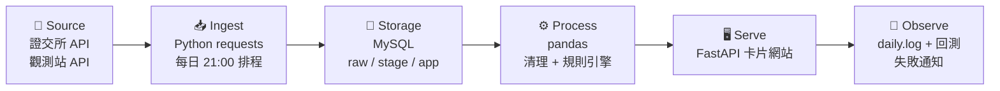

# 注意股，還差幾步？

> 一句話描述：為收盤後才看盤的短線、融資散戶，解決「自選股被列注意後，還差幾次會被處置、哪天開始受限」查不到的問題。

TibaMe 資料工程專題（NKR204），個人製作。2026/11 起實作，預計 12 月底 Demo。

---

## 為什麼做這個

台股有一套「注意 → 處置」制度：證交所每個交易日收盤後公布注意股，第 1–8 款的注意次數會累計，達到門檻（連 3 日、連 5 日、10 日內 6 次、30 日內 12 次）就成為**處置股**——撮合變慢、大額委託要先預收款券。

自選股被列注意時，散戶最想知道：這次會不會累計？還差幾次會被處置？如果明天再被列注意，從哪天開始受限？這些資訊今天散在 4 個地方（作業要點、證交所兩個公告頁面、觀測站逐家查詢），官方名單只列「只差一次」的股票，而且沒有歷史。

**本專案每個交易日替每檔注意股與處置股產生一張卡片**，只放可指回原文的事實：注意款次、四條累計路徑還差幾次（列出計入的日期）、若再列注意的處置日期、處置條件與措施、幾號出關、公司公告。

**不做的事：** 不預測漲跌、不推薦買賣、不判斷是否涉及炒作。範圍限上市公司股票（不含權證、ETF）。

---

## 系統架構

```
Source → Ingest → Storage → Process → Serve → Observe
```



| 階段 | 工具 |
|---|---|
| Source | 證交所 API（注意股、處置股、注意累計名單、開休市日期、市場成交、上市公司）、公開資訊觀測站 API（重大訊息、重大訊息全文） |
| Ingest | Python requests；Windows 工作排程器（之後 Airflow + Celery + RabbitMQ） |
| Storage | MySQL 三層：`raw_*`（API 原文）→ `stage_*`（清理後）→ `app_*`（引擎結果）；之後 Cloud SQL、BigQuery |
| Process | pandas：`transform/` 整理（raw → stage）、`analyze/` 規則引擎——依要點第六條算離處置還差幾次（stage → app） |
| Serve | FastAPI 卡片網站（個股卡片、卡片牆），只讀 `app_*` 表和 VIEW；Metabase → Looker Studio 儀表板 |
| Observe | `data/daily.log`、回測（真實處置 75 筆全部算到，條件也都對上）；之後失敗通知 |

順序是 ELT：原文先存進 raw，再清理、計算；規則改了可以從 raw 重算，不必重抓。每天只處理當天的資料。

地端（11 月）與雲端（12 月）架構圖：[`docs/images/architecture-local.png`](docs/images/architecture-local.png)、[`docs/images/architecture-cloud.png`](docs/images/architecture-cloud.png)。

### 產出

| 畫面 | 內容 |
| --- | --- |
| 個股卡片 | 今日款次、四條路徑還差幾次（列出計入的日期）、若再列注意的處置日期、處置中幾號出關、處置紀錄、近 30 個營業日公告 |
| 卡片牆 | 每間上市公司一張卡片（不含權證、ETF）；分頁：全部、注意股、聽牌、處置股、明日出關、今日出關 |
| 統計儀表板 | 各款次進入處置的比例、有無公告的差異、產業分布 |

線框圖見 [`docs/images/`](docs/images/)，詳細定義見 [`docs/proposal.md`](docs/proposal.md) 第 5 節。

### 專案結構

```
crawler/                    抓資料：API → raw（課程補充 J：producer → task → client → repository）
├─ producer.py                producer：決定今天要抓哪些任務、依序執行
├─ task.py                    task：每個 crawl_xxx 任務抓一份、存進 raw（Step 5 加 @app.task 給 Celery）
├─ client.py                  client：打證交所、觀測站 API（fetch_xxx，不存檔）
└─ http_utils.py              client 共用的 GET／POST
transform/                  轉換：raw → stage（同樣的 producer → task 寫法）
├─ producer.py                producer：產生任務清單（每份 raw 一個任務）並執行
├─ task.py                    task：transform_xxx，每個 crawl_xxx 對應一個
├─ transformer.py             transformer：每個資料集 xxx_to_frame 攤平、clean_xxx 整理
└─ parsing.py                 transformer 用的解析工具（去 HTML、轉數字、檢查欄位）
analyze/                    分析：stage → app（同樣的 producer → task 寫法）
├─ producer.py                producer：產生任務清單（每個日期一個任務）並依序執行
├─ task.py                    task：analyze_progress(date_yyyymmdd)，一天一個任務
├─ engine.py                  規則引擎：依要點第六條算還差幾次、若再列注意的處置日期、幾號出關
└─ backtest.py                回測（Observe）：引擎預測的處置 vs 真實處置公告
common/                     三個資料夾共用（彼此不互相 import，只用 common）
├─ repository.py              repository：連線、建表、raw 表讀寫、stage／app 表讀寫
├─ cli.py                     三個 producer 共用的指令參數（daily／backfill、--refetch）
├─ config.py                  設定（會因環境改變的值，從 .env 讀）
├─ constant.py                跨資料夾共用的固定值（stage 主鍵）；只有一個檔案用的寫在那個檔案裡
└─ date_utils.py              日期工具
schema/                     建表 SQL：raw.sql、stage.sql、app.sql、view.sql（給網頁讀的 VIEW）
scripts/                    .bat：每日排程（daily）、回補（backfill）、從 raw 重算（rebuild）、備份（backup）
tests/                      測試
docs/                       流程說明（flow.md）、資料表（tables.md）、處置規則（rules.md）、提案
main.py                     一次跑完：crawler → transform → analyze
```

---

## 快速開始

```bash
git clone https://github.com/hannahTai/G2-attention_stock_tracker-tw_stock.git
cd G2-attention_stock_tracker-tw_stock
cp .env.example .env   # 填入 MySQL 連線資訊
pip install -r requirements.txt
python main.py         # 抓今天 → 整理 → 算還差幾次
```

回補一段期間：`python main.py backfill --start 20260701`（已經抓完整的跳過，加 `--refetch` 全部重抓）。也可以用 uv：`uv sync` 後 `uv run python main.py`。
每一步單獨執行、排程設定見 [`docs/flow.md`](docs/flow.md)；資料表見 [`docs/tables.md`](docs/tables.md)；規則見 [`docs/rules.md`](docs/rules.md)。

---

## 團隊

| 成員 | 負責範圍 | GitHub |
|---|---|---|
| Hannah（個人製作） | Ingest：證交所、觀測站 API → raw 表 | @hannahTai |
| | Pipeline：每日排程、raw → stage → app 三層、回補 | |
| | Analytics：規則引擎（要點第六條）、回測 | |
| | Product：FastAPI 卡片網站 | |

---

## 進度追蹤

見 [task.md](task.md)

---

## License

MIT
