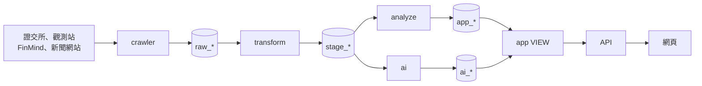

# 執行流程

| 步驟 | 讀 | 寫 | 做什麼 |
|---|---|---|---|
| crawler | API | `raw_*` | 抓資料，存原文 |
| transform | `raw_*` | `stage_*` | 整理成表 |
| analyze | `stage_*` | `app_*` | 規則引擎算離處置還差幾次 |
| ai | `stage_*`、前面的 AI 結果 | `ai_*` | 公告分類、新聞摘要、新聞 RAG、同一件事、卡片 AI 摘要 |

方框是步驟，圓柱是資料表。analyze 和 ai 都只讀 stage，互不讀對方的結果，同時跑；網站的 VIEW 再把兩邊合起來：



## 每天怎麼跑

排程週一～五 21:00 執行 `main.py`（期間算一次再傳給每一步）：

1. **crawler**：證交所先抓（要知道當天哪些股票被關注），之後觀測站（重大訊息清單 → 全文）、新聞（FinMind 清單 → 新聞網頁）兩條同時。某一份抓失敗就記下來，繼續抓下一份。
2. **transform**：每份 raw 整理成 stage。raw 沒抓到就跳過；程式出錯（例如官方改了欄位）就不跑 3、4。
3. **analyze**：先確認往前 30 個營業日的交易日、注意股、處置股都有資料，缺一天那天就不算（會算錯）；再算每檔離處置還差幾次。
4. **ai**：和 analyze 同時跑，順序是公告分類 → 新聞摘要 → 新聞 RAG → 同一件事 → 卡片 AI 摘要。失敗只影響 AI 的結果，網站照常。沒設 `ANTHROPIC_API_KEY` 就只做不用 Claude 的新聞 RAG、同一件事。

同一時間只跑一輪：開始前鎖住 `data/pipeline.lock`，上一輪還沒跑完就排隊等（最多 2 小時）。

## 有失敗時怎麼查、怎麼補

1. 昨晚有沒有成功：`Get-ScheduledTaskInfo G2-attention_stock_tracker-daily`，`LastTaskResult` 0＝成功、1＝有失敗。
2. 看 `data/logs/daily-YYYY-MM-DD.log` 裡標 `✗` 的行，或查任務歷史：`SELECT task, args, error FROM tw_stock.job_run WHERE status = 'failure' AND started_at >= CURRENT_DATE`。

| log 裡看到 | 意思 | 怎麼做 |
|---|---|---|
| `crawl_notice(date_yyyymmdd='20261113') ✗ 連線逾時` | 那一份沒抓到 | 補跑那天 |
| `transform 有任務失敗，不跑 analyze、ai` | 整理時程式出錯 | 修好程式再補跑 |
| `缺少必要的資料，不算進度：[...]` | 那天需要的資料還沒有 | 補跑那天 |

3. 補跑 11/13：`uv run python main.py backfill --start 20261113 --end 20261113`。重跑不會重複（見下面的冪等）。也可以從出錯的那一步開始一步一步跑：

```
uv run python -m crawler.producer   backfill --start 20261113 --end 20261113
uv run python -m transform.producer backfill --start 20261113 --end 20261113
uv run python -m analyze.producer   backfill --start 20261113 --end 20261113
uv run python -m ai.producer        backfill --start 20261113 --end 20261113
```

- 改了規則或 transform，要從 raw 重算一段期間：`scripts\run_rebuild.bat 20260701`（先跑測試，再跑 transform、analyze，不打 API）。
- 官方事後更正了某天的資料：`main.py backfill --start <那天>`。還差幾次要往回看 30 個營業日，所以會一起重算到今天。
- 注意累計名單只有最新一份，漏跑要在下一個交易日收盤前補。

## crawler：API → raw

| 資料 | API | 一份涵蓋 | raw_key |
|---|---|---|---|
| 開休市日期 | `holidaySchedule` | 一年 | `2026` |
| 每日市場成交 | `afterTrading/FMTQIK` | 一個月 | `202611` |
| 每日收盤行情 | `afterTrading/MI_INDEX`（`type=ALLBUT0999`） | 一天 | `20261120` |
| 注意股 | `announcement/notice` | 一天 | `20261113` |
| 處置股 | `announcement/punish`（查當天～＋14 天） | 一天 | `20261113` |
| 上市公司清單 | OpenAPI `t187ap03_L` | 快照 | 抓取日期 |
| 注意累計名單 | `announcement/notetrans`（只有最新一份） | 一天 | 名單日期 |
| 重大訊息 | 觀測站 `t05st01` | 一家一個月 | `1303_202611` |
| 重大訊息全文 | 觀測站 `t05st01_detail`（DR 是 `t59sb01_detail`） | 一則公告 | `9908_20261102_1` |
| 個股新聞 | FinMind `TaiwanStockNews` | 一檔一天（UTC） | `2330_20261120` |
| 新聞網頁 | 每則新聞的連結 | 一則新聞 | news_id＝連結的 md5 |

- 重大訊息、新聞只查當天被關注的上市公司（被列注意、處置中）：重大訊息查當月和上個月，新聞查那天和往前 7 天（`NEWS_LOOKBACK_DAYS`）。
- 新聞網頁不存全文（著作權），只存 `<head>`（標題、導言）、轉址後的網址、全文字數。論壇貼文不抓；被擋、轉址這類永久失敗記一列，之後不再抓。
- raw 只新增不修改，成功、失敗都留；讀的時候只拿最新一份成功的。
- 已經抓完整的不再抓（加 `--refetch` 全部重抓）。「完整」＝資料不會再變之後抓的：注意股、處置股、收盤行情是那天 20:00 以後；一個月的資料是那個月過完以後；FinMind 新聞是隔天 08:00 以後。
- 暫時性的失敗（逾時、5xx、429）等 5 秒重試，最多 3 次；內容不對、被擋不重試。

## transform：raw → stage

- 一個 crawl 任務對應一個 transform 任務，例如 `crawl_notice` → `transform_notice`；只讀成功的 raw，任務之間互不依賴。
- 注意股、款次：那天先清掉再寫入（官方拿掉的列也會消失）。其他：用主鍵更新，這批沒有的列不動。
- 重大訊息條款對照表（第 1～51 款）是固定資料，寫在 `schema/stage.sql`。

## 去重與冪等

同一段期間重跑幾次、分到好幾個 worker 同時跑，結果都一樣：

| 層 | 怎麼寫 |
|---|---|
| raw | 只新增，每抓一次一列（主鍵含 `fetched_at`） |
| stage | `INSERT … ON CONFLICT (主鍵) DO UPDATE`，只讓比較新的抓取（`source_fetched_at`）覆蓋；同一批主鍵重複的先只留最新一列 |
| app | 同一個交易裡先刪那天、再寫入 |
| ai | 同一個 prompt 版本已經有結果的不再問；重算 stage、app 不會刪掉 AI 結果 |

驗證：`uv run pytest -m integration`（另建測試用資料庫，測完刪掉；包含 8 個執行緒同時寫同一筆，最後一定是最新的）。

## ai：stage → ai

| 項目 | 任務 | 一次處理 | 寫入 |
|---|---|---|---|
| 公告分類 | `classify_announcement` | 一則公告 | `ai_announcement_label` |
| 新聞摘要 | `summarize_news` | 一則新聞（被關注的股票、全文至少 200 字） | `ai_news_summary` |
| 新聞 RAG | `embed_news` | 一天的新聞 | `ai_news_embedding` |
| 同一件事 | `group_news_stories` | 整段區間 | `ai_news_story` |
| 卡片 AI 摘要 | `summarize_card` | 一檔一天（今天被列注意、在注意累計名單上的上市公司） | `ai_card_summary` |

- 模型：Claude（`.env` 的 `AI_*_MODEL`，預設 `claude-haiku-5-5`），照 JSON schema 回答；新聞 RAG 用本機的 bge-m3（不花錢，存在 pgvector）。
- 新聞摘要的全文不存：任務當場再打開網頁，交給 Claude 後就丟掉。
- 卡片 AI 摘要：程式把注意股的原因、處置中的期間、今天的漲跌幅、近 30 天公告、新聞 RAG 挑出的新聞先查好，Claude 只負責寫成白話，重點是「為什麼漲跌」；不寫規定、不預測、不給買賣建議。輸入和前一天一樣就沿用前一天的摘要。
- 防呆：摘要裡的數字都要出現在原文裡、不超過字數上限，才算 `summary_ok`（網站只顯示通過的）；太長就請 Claude 縮短一次。每次呼叫記一列 `ai_llm_call`（token、花費）。

## 常用指令

```
uv run python main.py                                   # 跑完今天
uv run python main.py backfill --start 20260701         # 跑一段期間（可加 --end；--refetch 全部重抓）
uv run python -m crawler.producer [backfill --start ...]  # 只跑一步，transform、analyze、ai 同樣
uv run python -m analyze.backtest                       # 回測
uv run pytest                                           # 測試（連不到 PostgreSQL 的整合測試自動跳過）
```

改了 `schema/` 的欄位：程式不會刪表重建，要自己下 `ALTER TABLE`。

## 備份

`scripts/backup_db.py`：pg_dump 整個資料庫 → `data/backup/tw_stock_<日期>_<時間>.sql.gz`，留最近 14 份（不鎖表；`.env` 可設 `BACKUP_DIR`）。

還原（會蓋掉整個 tw_stock）：

```bash
gzip -dc data/backup/tw_stock_20261114_233000.sql.gz | wsl docker exec -i postgres psql -U postgres -d postgres
```

## 排程（Windows 工作排程器）

| 工作 | 時間 | 執行 | log |
|---|---|---|---|
| `G2-attention_stock_tracker-daily` | 週一～五 21:00 | `scripts\run_daily.bat` | `data/logs/daily-YYYY-MM-DD.log` |
| `G2-attention_stock_tracker-backup` | 週一～五 23:30 | `scripts\run_backup.bat` | `data/backup.log` |

- 背景執行（`conhost.exe --headless`）；錯過時開機後補跑；關機或睡眠時不會跑。log 留 30 天，永久的紀錄是 `tw_stock.job_run`。
- `Start-ScheduledTask <工作名稱>` 手動跑一次；`Get-ScheduledTaskInfo <工作名稱>` 看結果。

重灌時重建（backup 換檔名、時間，加 `-ExecutionTimeLimit (New-TimeSpan -Hours 1)`）：

```powershell
$action   = New-ScheduledTaskAction -Execute conhost.exe -Argument "--headless cmd.exe /c `"$(Resolve-Path scripts\run_daily.bat)`""
$trigger  = New-ScheduledTaskTrigger -Weekly -DaysOfWeek Monday,Tuesday,Wednesday,Thursday,Friday -At 21:00
$settings = New-ScheduledTaskSettingsSet -StartWhenAvailable
Register-ScheduledTask -TaskName G2-attention_stock_tracker-daily -Action $action -Trigger $trigger -Settings $settings
```
