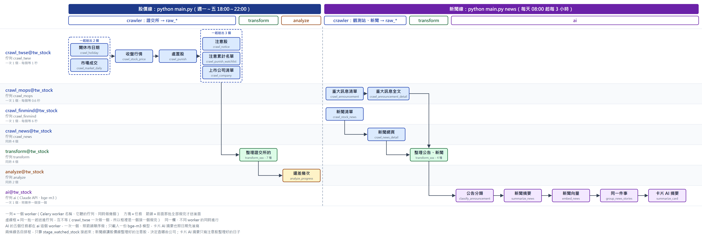
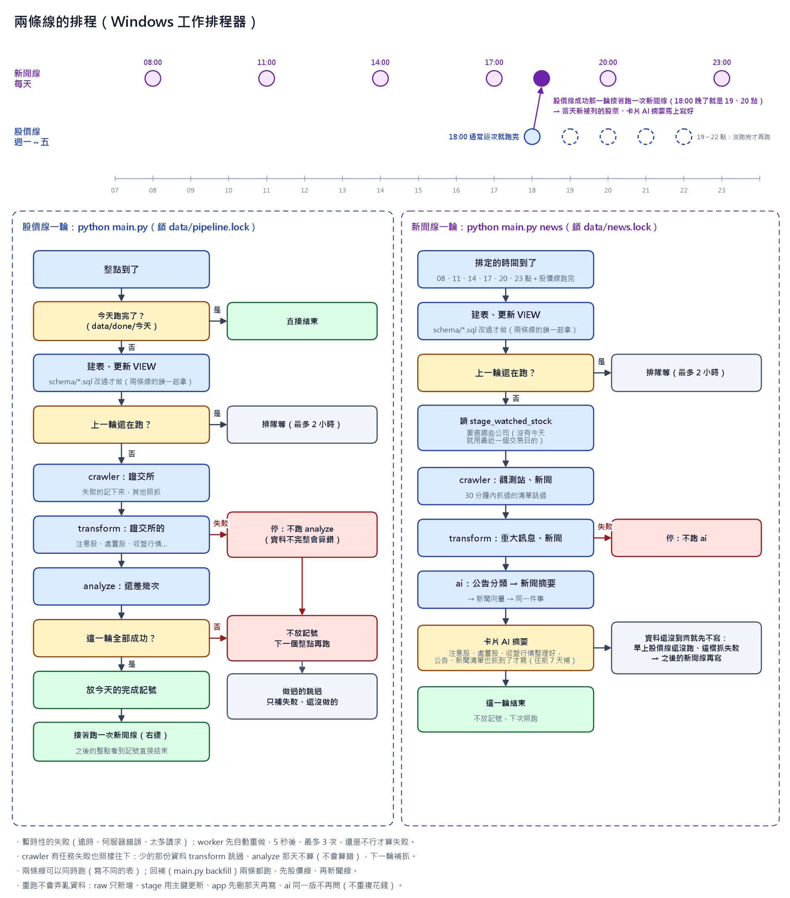

# 任務與佇列

> 2026-11-23 整理，2026-11-24 更新

## 一張圖看懂

Celery 把「決定要做什麼」和「真的去做」分開，中間用 RabbitMQ 排隊：

```
producer（列出要做的任務）
  → RabbitMQ（7 個佇列，任務在這裡排隊）
  → worker（7 個，各自從自己的佇列拿任務去做）
  → PostgreSQL（寫結果）
  → 做完回報給 producer
```

| 角色 | 在這個專案 | 比喻 |
|---|---|---|
| producer | `crawler/`、`transform/`、`analyze/`、`ai/` 各一個 `producer.py` | 主管：寫工作單 |
| 佇列（RabbitMQ） | 7 個佇列 | 收件匣：工作單在這裡排隊 |
| worker | 7 個 `celery-*` 容器，一個聽一個佇列 | 員工：從自己的收件匣拿工作單去做 |

一個任務＝一件小事，例如「抓 11/23 的注意股」「替這則新聞寫摘要」。

## 所有任務和 worker

資料線分兩條：股價線（證交所 → 整理 → 還差幾次）、新聞線（觀測站、新聞 → 整理 → AI）。後面的任務要用前面的結果，所以 producer 一步做完才送下一步。同一步的任務互不等。



表裡的「佇列」是任務送進哪個佇列；聽這個佇列的 worker 見下面「7 個 worker」。

| 線 | 步驟 | 任務 | 佇列 | 為什麼排在這裡 |
|---|---|---|---|---|
| 股價線 | 1 | `crawl_holiday` 開休市日期、`crawl_market_daily` 市場成交 | `crawl_twse` | 判斷那天是不是交易日的依據，最先抓 |
| 股價線 | 2 | `crawl_stock_price` 收盤行情 | `crawl_twse` | 要先知道那天該不該有交易 |
| 股價線 | 3 | `crawl_punish` 處置股 | `crawl_twse` | 同上 |
| 股價線 | 4 | `crawl_notice` 注意股、`crawl_punish_watchlist` 注意累計名單、`crawl_company` 公司清單 | `crawl_twse` | 注意股還沒公布時名單是空的；和它一起公布的處置股公布了，空名單才代表真的沒人被列 |
| 股價線 | 5 | `transform_xxx` 整理證交所的（7 種） | `transform` | 要先抓好 |
| 股價線 | 6 | `analyze_progress` 還差幾次 | `analyze` | 只讀整理好的資料 |
| 新聞線 | 1 | `crawl_announcement` 重大訊息清單 → `crawl_announcement_detail` 全文 | `crawl_mops` | 查哪些公司讀 `stage_watched_stock`（股價線整理好的注意股）；和下一列同時 |
| 新聞線 | 1 | `crawl_stock_news` 新聞清單 → `crawl_news_detail` 新聞網頁 | `crawl_finmind` → `crawl_news` | 同上 |
| 新聞線 | 2 | `transform_xxx` 整理重大訊息、新聞（4 種） | `transform` | 要先抓好 |
| 新聞線 | 3 | `classify_announcement` 公告分類 | `ai` | AI 照這個順序：後面的用前面的結果；呼叫 Claude |
| 新聞線 | 3 | `summarize_news` 新聞摘要 | `ai` | 呼叫 Claude |
| 新聞線 | 3 | `embed_news` 新聞向量 | `ai` | 要用 bge-m3 把「標題＋摘要」轉成向量（摘要要先寫好） |
| 新聞線 | 3 | `group_news_stories` 同一件事 | `ai` | 只比資料庫裡已經有的向量，不用模型 |
| 新聞線 | 3 | `summarize_card` 卡片 AI 摘要 | `ai` | 查詢也要用 bge-m3 轉成向量，才能挑相關的新聞；再呼叫 Claude。只寫那天的注意股、處置股、收盤行情都整理好的日子（股價線跑完以後） |

AI 這段五個任務都在 `ai` 一個 worker，一次做一個：只有它載入本機 embedding 模型（bge-m3，約 2.3 GB 記憶體，只載一份）。順序不能換：向量要用摘要、歸類要用向量、卡片摘要要用前面全部的結果。

## 兩條線的排程

- **股價線**：週一～五 18:00～22:00，每個整點跑一次 `main.py`。
- **新聞線**：每天 08:00、11:00、14:00、17:00、20:00、23:00 跑一次 `main.py news`；股價線成功的那一輪放完記號也接著跑一次（18:00，證交所晚公布就是 19:00、20:00…）。
- 同一條線同一時間只跑一輪：上一輪還沒跑完，這一輪排隊等。兩條線可以同時跑（寫不同的表）。



| 哪裡失敗 | 這一輪 |
|---|---|
| crawler 的某個任務 | 其他的照抓；後面照跑（用已經抓到的）。少的那份資料：transform 跳過、analyze 那天不算，不會算錯 |
| transform | **停**：股價線不跑 analyze、新聞線不跑 ai（stage 不完整，算出來會錯） |
| ai | 只影響 AI 的結果；還差幾次是股價線算的，不受影響 |

- **股價線全部成功**：放當天的完成記號（`data/done/YYYYMMDD`），接著跑一次新聞線；之後的整點看到記號就直接結束。
- **股價線有任何失敗**：不放記號，**下一個整點再跑一輪**：做過的跳過，只補失敗、還沒做的。
- **新聞線**不放記號：每次都跑，已經抓完整的跳過；還會變的清單（當月的重大訊息、還沒過完的那天的新聞）30 分鐘內剛抓過的也跳過。
- **卡片 AI 摘要**：股價線把當天的注意股、處置股、收盤行情整理好以後，接著跑的那次新聞線就寫（一檔一天一次）。每一檔還要那天的新聞清單、那個月的公告清單抓到了才寫（當天新被列、還沒抓到或抓失敗的，下一輪抓到了再寫）。沒寫成的（股價線很晚才跑完、最後一次新聞線失敗）之後的新聞線會補：往前看 7 天，補還沒寫的。
- 暫時性的失敗（逾時、伺服器錯誤、太多請求）在這一輪裡就先自動重做（5 秒後，最多 3 次）；worker 掛掉，沒做完的任務回到佇列給別人做。

## 重跑不會怎樣

同一天重跑幾次、好幾個 worker 同時做，結果都一樣：

| 層 | 重跑時 |
|---|---|
| raw | 已經抓完整的不再抓；抓了就新增一列，舊的不改 |
| stage | 用主鍵更新，比較新的抓取才蓋掉舊的 |
| app | 先刪那天、再寫入（同一個交易） |
| ai | 同一版 prompt 已經有結果的不再問，不會重複花錢 |

## 7 個 worker

一個 worker 聽一個佇列。三個名字各用在不同地方：Docker 服務（`wsl docker compose restart`）、Celery worker 名稱（Flower、`job_run.worker`）、佇列（RabbitMQ、送任務時指定）。

| Docker 服務 | Celery worker 名稱 | 聽的佇列 | 做什麼 | 同時做幾個 | 為什麼是這個數字 |
|---|---|---|---|---|---|
| `celery-crawl-twse` | `crawl_twse@tw_stock` | `crawl_twse` | 抓證交所 | 1，每個等 1 秒 | 太快會被擋 |
| `celery-crawl-mops` | `crawl_mops@tw_stock` | `crawl_mops` | 抓公開資訊觀測站 | 1，每個等 0.6 秒 | 太快會被擋 |
| `celery-crawl-finmind` | `crawl_finmind@tw_stock` | `crawl_finmind` | 抓 FinMind 新聞清單 | 1，每個等 6 秒 | 每小時上限 600 次 |
| `celery-crawl-news` | `crawl_news@tw_stock` | `crawl_news` | 打開新聞網頁 | 4 | 分散在十幾個網站 |
| `celery-transform` | `transform@tw_stock` | `transform` | raw → stage | 4 | 只碰資料庫 |
| `celery-analyze` | `analyze@tw_stock` | `analyze` | 算還差幾次 | 2 | 只碰資料庫 |
| `celery-ai` | `ai@tw_stock` | `ai` | 呼叫 Claude、用 bge-m3 轉向量、寫卡片摘要 | 1 | 模型吃 2.3 GB 記憶體，每多一個就多載一份；卡片摘要要照日期先後寫 |

**為什麼要分這麼多個**：Celery 的「同時做幾個」設在 worker 上，所以每個來源要自己的速度，就要自己的佇列和 worker。只用一個佇列會：

- 好幾個 worker 同時打觀測站，被擋好幾個小時；
- FinMind 6 秒一個的任務排在前面，後面的全部跟著等；
- 每個 worker 都可能拿到要用模型的任務，每個都載入一份 2.3 GB。

## 怎麼看

- **Flower**（http://localhost:5556，`.env` 的 `FLOWER_USER`／`FLOWER_PASSWORD` 登入）：每個 worker 在做什麼、成功或失敗。
- **RabbitMQ 管理介面**（http://localhost:15673）：Queues 頁的 Ready＝每個佇列還排幾個。
- **任務歷史**：每個任務每跑一次一列。

```sql
SELECT task, status, count(*), round(avg(seconds), 1) AS avg_seconds
FROM tw_stock.job_run
WHERE started_at >= CURRENT_DATE
GROUP BY task, status
ORDER BY task, status;
```
