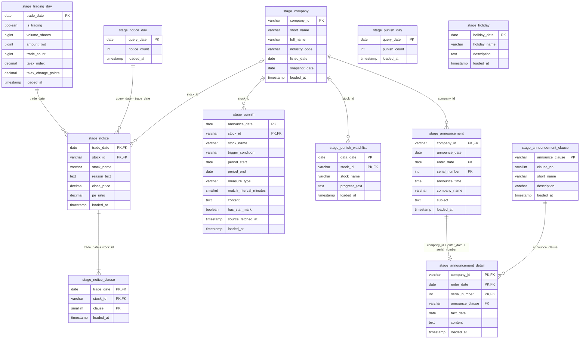

# 資料表說明

資料庫分三層：

| 層 | 表名開頭 | 內容 | 建表 SQL |
|---|---|---|---|
| raw | `raw_` | API 回應原文 | [`schema/raw.sql`](../schema/raw.sql) |
| stage | `stage_` | raw 整理後的官方資料，不做業務判斷 | [`schema/stage.sql`](../schema/stage.sql) |
| app | `app_` | 規則引擎算出的結果，給網頁讀 | [`schema/app.sql`](../schema/app.sql) |
| app（VIEW） | `app_` | 網頁需要的 stage 欄位，網頁只讀 `app_*` | [`schema/view.sql`](../schema/view.sql) |

每天只處理當天的資料（見 [`flow.md`](flow.md)）；每張表另有 `loaded_at`（寫入時間）。時間欄位（`fetched_at`、`loaded_at`）都是 TIMESTAMP（不含時區）、台灣時間。期間為 2026/11/14 的資料。

## raw 層

一個來源一張表，欄位都一樣；一列＝抓一次的 API 回應。

| 欄位 | 型別 | 說明 |
|---|---|---|
| raw_key | VARCHAR(30) | 主鍵之一，例如 `20261113`、`202611`、`2026`、`1303_202611` |
| fetched_at | TIMESTAMP(6) | 主鍵之一；抓取時間（台灣時間） |
| http_status | SMALLINT | HTTP 狀態碼 |
| ok | BOOLEAN | 成功且內容檢查通過；transform 只讀 ok 的列 |
| problem | TEXT | 失敗原因；成功為 NULL |
| url | TEXT | 請求網址（含查詢參數） |
| request_body | TEXT | POST 的參數（JSON 字串）；GET 為 NULL |
| body | TEXT | API 回應原文（JSON 字串） |

| 表 | raw_key | 整理成 |
|---|---|---|
| `raw_notice` | 查詢日期 | `stage_notice`、`stage_notice_clause`、`stage_notice_day` |
| `raw_punish` | 查詢日期 | `stage_punish`、`stage_punish_day` |
| `raw_punish_watchlist` | 名單上的資料日期 | `stage_punish_watchlist` |
| `raw_market_daily` | 月份 | `stage_trading_day` |
| `raw_stock_price` | 查詢日期 | `stage_stock_price` |
| `raw_holiday` | 西元年 | `stage_holiday` |
| `raw_company` | 抓取日期 | `stage_company` |
| `raw_announcement` | 公司代號_月份 | `stage_announcement` |
| `raw_announcement_detail` | 公司代號_輸入日期_序號 | `stage_announcement_detail` |

- 只新增、不修改：主鍵（raw_key, fetched_at），同一個 raw_key 每抓一次多一列，成功、失敗都留。transform 只讀每個 raw_key 最新一份成功的，所以失敗不會蓋掉之前成功的。

## stage 層

每張表（固定資料的 `stage_announcement_clause` 除外）最後都有兩欄：`loaded_at`（寫入時間）、`source_fetched_at`（TIMESTAMP(6)，
這列來自哪次抓取，也就是 raw 的 `fetched_at`）。寫入時用主鍵更新，只讓 `source_fetched_at` 比較新（或一樣新）的覆蓋，見 [`flow.md`](flow.md)「去重與冪等」。

| 表 | 一列是 | 主鍵 | 期間 |
|---|---|---|---|
| `stage_notice` | 某天某檔的注意股 | trade_date, stock_id | 05/04–11/20 |
| `stage_notice_clause` | 某天某檔的一個款次 | trade_date, stock_id, clause | 05/04–11/20 |
| `stage_notice_day` | 一天的注意股查過了（幾檔；休市日也有一列） | query_date | 05/01–11/20 |
| `stage_punish` | 一則處置公告 | announce_date, stock_id | 04/17–11/20（含 05/01 仍在處置中的） |
| `stage_punish_day` | 一天的處置股抓到了（幾則） | query_date | 05/01–11/20 |
| `stage_punish_watchlist` | 官方注意累計名單的一檔 | data_date, stock_id | 11/09–11/20（API 只有最新一天，11/09 開始每天抓） |
| `stage_trading_day` | 一天（有沒有交易） | trade_date | 05/01–11/20 |
| `stage_stock_price` | 某天某檔的收盤行情（那天有成交的） | trade_date, stock_id | 05/04–11/20 |
| `stage_holiday` | 官方開休市日期的一天 | holiday_date | 2026、2027 全年 |
| `stage_company` | 一家上市公司 | company_id | 11/20 快照 |
| `stage_announcement` | 一則重大訊息 | company_id, enter_date, serial_number | 04/01–11/20（發言日期；7,391 則） |
| `stage_announcement_detail` | 一則重大訊息的全文 | company_id, enter_date, serial_number | 同上（輸入日期最早 03/17） |
| `stage_announcement_clause` | 一個符合條款（固定資料，51 列） | announce_clause | — |

## 關聯圖

- PK＝主鍵，FK＝關聯到另一張表的欄位；關聯是邏輯上的，資料庫沒設 FK。

## 欄位

「API 欄位」是資料列裡的欄位名稱；證交所的資料列是陣列，名稱在 `fields`（觀測站在 `result.titles`）。依欄名取值：官方多加欄位、調整順序都不影響，用到的欄位不見了 transform 才會報錯。轉換規則在 `transform/transformer.py`。

### stage_notice　注意股

- 來源：`raw_notice`（證交所 `GET /rwd/zh/announcement/notice` → `data`）
- 沒用到：編號、累計次數（不是個股的累計次數）

| 欄位 | 型別 | API 欄位 | 轉換／說明 |
|---|---|---|---|
| trade_date | DATE | 日期 | 民國 → 西元 |
| stock_id | VARCHAR(10) | 證券代號 | — |
| stock_name | VARCHAR(50) | 證券名稱 | — |
| reason_text | TEXT | 注意交易資訊 | 去 HTML |
| close_price | DECIMAL(12,4) | 收盤價 | 文字 → 數字 |
| pe_ratio | DECIMAL(12,4) | 本益比 | 文字 → 數字；沒有為 NULL |

### stage_notice_clause　注意款次

- 來源：`raw_notice` 的注意交易資訊（和 `stage_notice` 一起產生）

| 欄位 | 型別 | API 欄位 | 轉換／說明 |
|---|---|---|---|
| trade_date | DATE | 日期 | 民國 → 西元 |
| stock_id | VARCHAR(10) | 證券代號 | — |
| clause | SMALLINT | 注意交易資訊 | 每個「第X款」一列，1～14 |

- 第 1–8 款會累計，第 9–14 款不累計。找不到款次時 transform 會報錯。

### stage_notice_day　注意股（每個查詢日一列）

- 來源：`raw_notice`（和 `stage_notice` 一起產生）

| 欄位 | 型別 | 說明 |
|---|---|---|
| query_date | DATE | 查詢的那天（休市日也會查，所以不一定是交易日） |
| notice_count | INT | 那天幾檔被列注意；0＝沒人被列（休市日一定是 0） |

- 用來分辨「那天沒人被列」（有這列，0 檔）和「還沒抓到」（沒有這列）。analyze 算之前會檢查。
- 跟 `stage_punish_day` 一樣用 `query_date`：兩張都是「這天查過了」的標記表，日期是查詢日，不是交易日。

### stage_punish　處置股

- 來源：`raw_punish`（證交所 `GET /rwd/zh/announcement/punish`，當天～當天＋14 天 → `data`）
- 沒用到：編號、累計、備註

| 欄位 | 型別 | API 欄位 | 轉換／說明 |
|---|---|---|---|
| announce_date | DATE | 公布日期 | 民國 → 西元（去掉 *） |
| stock_id | VARCHAR(10) | 證券代號 | — |
| stock_name | VARCHAR(50) | 證券名稱 | — |
| trigger_condition | VARCHAR(50) | 處置條件 | 例如「連續三次」 |
| period_start | DATE | 處置起迄時間 | `～` 前半，民國 → 西元 |
| period_end | DATE | 處置起迄時間 | `～` 後半，民國 → 西元 |
| measure_type | VARCHAR(20) | 處置措施 | 第一次／第二次處置 |
| match_interval_minutes | SMALLINT | 處置內容 | 抓「約每X分鐘」；沒寫為 NULL |
| content | TEXT | 處置內容 | — |
| has_star_mark | BOOLEAN | 公布日期 | 是否以 * 開頭（意義未確認） |
| source_fetched_at | TIMESTAMP(6) | （raw 的 fetched_at） | 這列來自哪次抓取 |

- 同一則公告每天都會查到，寫入時用主鍵更新，留最後抓到的（比 `source_fetched_at`）；同一批裡重複的，後面的蓋掉前面的。
- API 篩的是處置期間，所以公布日期會比抓取期間早；回測要往前多抓幾週。

### stage_punish_day　處置股（每天一列）

- 來源：`raw_punish`（和 `stage_punish` 一起產生）

| 欄位 | 型別 | 說明 |
|---|---|---|
| query_date | DATE | 查詢的那天 |
| punish_count | INT | 查到幾則處置公告（那天起 14 天內處置中的）；0＝沒有 |

- 用來分辨「沒有處置」和「還沒抓到」。analyze 算之前會檢查。

### stage_punish_watchlist　注意累計名單

- 來源：`raw_punish_watchlist`（證交所 `GET /rwd/zh/announcement/notetrans` → `data`）
- 沒用到：編號

| 欄位 | 型別 | API 欄位 | 轉換／說明 |
|---|---|---|---|
| data_date | DATE | `title` | 取標題裡的日期，民國 → 西元 |
| stock_id | VARCHAR(10) | 證券代號 | — |
| stock_name | VARCHAR(50) | 證券名稱 | — |
| progress_text | TEXT | 近期達本公司「公布注意交易資訊」標準之情形 | ` ` → 換行，去 HTML |

- 官方答案，用來驗證規則引擎的「只差一次」。

### stage_trading_day　交易日曆

- 來源：`raw_market_daily`（證交所 `GET /rwd/zh/afterTrading/FMTQIK`，一次一個月 → `data`）
- 每天一列：從那個月 1 號寫到這份資料涵蓋到的那天。

| 欄位 | 型別 | API 欄位 | 轉換／說明 |
|---|---|---|---|
| trade_date | DATE | 日期 | 民國 → 西元 |
| is_trading | BOOLEAN | — | 資料裡有這天＝true；涵蓋範圍內但沒有＝false（週末、休市、颱風假） |
| volume_shares | BIGINT | 成交股數 | 文字 → 數字 |
| amount_twd | BIGINT | 成交金額 | 文字 → 數字（元） |
| trade_count | BIGINT | 成交筆數 | 文字 → 數字 |
| taiex_index | DECIMAL(12,2) | 發行量加權股價指數 | 文字 → 數字 |
| taiex_change_points | DECIMAL(12,2) | 漲跌點數 | 文字 → 數字 |

- 以實際成交為準，臨時休市也正確；「連續營業日」用 `is_trading` 為 true 的列。
- 涵蓋到哪天看抓取時間：15:00（收盤資料公布）以後抓的含當天，之前抓的只到前一天。之後的日子沒有列＝還不知道，analyze 不會算。
- 沒交易的日子成交欄位都是 NULL。

### stage_stock_price　每日收盤行情

- 來源：`raw_stock_price`（證交所 `GET /rwd/zh/afterTrading/MI_INDEX?type=ALLBUT0999`，一次一天 → `tables` 裡有「證券代號」「收盤價」欄位的那張）
- 全部上市股票、ETF，不含權證、牛熊證。那天沒成交（收盤價「--」）的不放。

| 欄位 | 型別 | API 欄位 | 轉換／說明 |
|---|---|---|---|
| trade_date | DATE | — | 回應的列沒有日期，用查詢的那天 |
| stock_id | VARCHAR(10) | 證券代號 | 去空白 |
| stock_name | VARCHAR(50) | 證券名稱 | 去空白 |
| open_price | DECIMAL(10,2) | 開盤價 | 文字 → 數字 |
| high_price | DECIMAL(10,2) | 最高價 | 文字 → 數字 |
| low_price | DECIMAL(10,2) | 最低價 | 文字 → 數字 |
| close_price | DECIMAL(10,2) | 收盤價 | 文字 → 數字 |
| volume_shares | BIGINT | 成交股數 | 文字 → 數字 |

- 卡片上的收盤價從這裡拿（`app_card.close_price`）；注意股公告也有收盤價，但只有當天被列的才有。

### stage_holiday　開休市日期

- 來源：`raw_holiday`（證交所 `GET /rwd/zh/holidaySchedule/holidaySchedule`，`date`＝那年 1 月 1 日 → `data`）

| 欄位 | 型別 | API 欄位 | 轉換／說明 |
|---|---|---|---|
| holiday_date | DATE | 日期 | 本來就是西元 |
| holiday_name | VARCHAR(100) | 名稱 | — |
| description | TEXT | 說明 | — |

- 也含「開始交易日」這類有交易的日子；不含臨時休市。
- 年份要用 `date` 指定，`queryYear` 會被忽略。

### stage_company　上市公司

- 來源：`raw_company`（證交所 OpenAPI `GET /v1/opendata/t187ap03_L` → 整個清單），只讀最新一份，依 company_id 更新（新的新增；下市的公司留著，snapshot_date 停在最後出現那天）
- 沒用到：其餘 28 個欄位

| 欄位 | 型別 | API 欄位 | 轉換／說明 |
|---|---|---|---|
| company_id | VARCHAR(10) | 公司代號 | — |
| short_name | VARCHAR(50) | 公司簡稱 | — |
| full_name | VARCHAR(200) | 公司名稱 | — |
| industry_code | VARCHAR(10) | 產業別 | — |
| listed_date | DATE | 上市日期 | 本來就是西元 |
| snapshot_date | DATE | `raw_key` | raw 的抓取日期 |

- 只有現行上市公司。
- 含少數 DR（台灣存託憑證：外國公司在台上市的憑證，代號 91 開頭 6 碼，例如 `911868 同方友友-DR`）。

### stage_announcement　重大訊息

- 來源：`raw_announcement`（觀測站 `POST /mops/api/t05st01`，一家公司一個月 → `result.data`）
- `code` 406＝那個月沒有公告

| 欄位 | 型別 | API 欄位 | 轉換／說明 |
|---|---|---|---|
| company_id | VARCHAR(10) | 公司代號 | — |
| announce_date | DATE | 發言日期 | 民國 → 西元 |
| enter_date | DATE | 詳細資料 的 `parameters.enterDate` | `1151102` → 日期；輸入日期 |
| serial_number | INT | 詳細資料 的 `parameters.serialNumber` | 輸入日期當天第幾則 |
| announce_time | TIME | 發言時間 | 判斷收盤前／後 |
| company_name | VARCHAR(50) | 公司名稱 | — |
| subject | TEXT | 主旨 | 接回被換行切斷的字 |

- 只有被列注意或處置的公司，查當月和上個月。
- 序號依輸入日期編，同一天發言的公告可能同號，所以主鍵用 enter_date。

### stage_announcement_detail　重大訊息全文

- 來源：`raw_announcement_detail`（觀測站 `POST /mops/api/t05st01_detail`，一則公告 → `result.data`）
- 主鍵和 `stage_announcement` 相同，一則公告一列；主鍵從 raw_key（`9908_20261102_1`）取，回應裡沒有輸入日期。
- 發言人姓名、職稱、電話是個資，只留在 raw，不放進 stage。
- 存託憑證（DR，`t59sb01_detail`）格式不同：沒有「說明」，`content` 取「發生依外國發行人…應即申報之重大情事」＋「其他」；`announce_clause` 是另一份規定的 `第五條第N款`，對不到 `stage_announcement_clause`（`clause_name` 為 NULL）。

| 欄位 | 型別 | API 欄位 | 轉換／說明 |
|---|---|---|---|
| company_id | VARCHAR(10) | （raw_key） | — |
| enter_date | DATE | （raw_key） | `20261102` → 日期 |
| serial_number | INT | （raw_key） | 輸入日期當天第幾則 |
| announce_clause | VARCHAR(20) | 符合條款 | 例如 `第31款`（觀測站的公告分類；和注意股的款次 `stage_notice_clause.clause` 是不同東西） |
| fact_date | DATE | 事實發生日 | 民國 → 西元 |
| content | TEXT | 說明 | 全文；換行統一成 `\n` |

### stage_announcement_clause　重大訊息條款對照表

- 固定資料，不用爬：寫在 `schema/stage.sql`，每次建表（transform 開始時）一併寫入／更新。條文修正時改那裡。
- 來源：證交所《對有價證券上市公司重大訊息之查證暨公開處理程序》第 4 條第 1 項（115.09.30 版），共 51 款（第 39 款已刪除）。
- `short_name`、`description` 是整理後的摘要，不是條文原文。第 51 款是概括條款（其他重大事項），被列注意後公司被要求公布的財務業務資訊也是這款。

| 欄位 | 型別 | 說明 |
|---|---|---|
| announce_clause | VARCHAR(20) | 主鍵，例如 `第31款`（和 `stage_announcement_detail.announce_clause` 一樣） |
| clause_no | SMALLINT | 款次數字，排序用 |
| short_name | VARCHAR(20) | 簡短名稱（卡片標籤），例如 `財務報告`、`法人說明會`、`其他重大事項` |
| description | VARCHAR(200) | 條文摘要 |

## app 層

規則引擎（`analyze/engine.py`）的結果，規則見 [`rules.md`](rules.md)。只有最近 30 個營業日被列過注意的股票才有一列。

每個交易日的結果都留著；重跑某天只換掉那天的列，`process_date` 記最後一次是哪天算的。

### app_progress　離處置還差幾次

主鍵：trade_date, stock_id

| 欄位 | 型別 | 說明 |
|---|---|---|
| trade_date | DATE | 交易日 |
| stock_id | VARCHAR(10) | 證券代號 |
| count_start | DATE | 從哪天開始算（上次處置公告的隔一個營業日） |
| streak3 | SMALLINT | 連續幾天被列第 1 款（門檻 3） |
| streak5 | SMALLINT | 連續幾天被列第 1～8 款（門檻 5） |
| in10 | SMALLINT | 最近 10 個營業日內幾天被列第 1～8 款（門檻 6） |
| in30 | SMALLINT | 最近 30 個營業日內幾天被列第 1～8 款（門檻 12） |
| streak3_left | SMALLINT | 連 3 日還差幾次（1＝只差一次） |
| streak5_left | SMALLINT | 連 5 日還差幾次 |
| in10_left | SMALLINT | 10 日 6 次還差幾次（已算進會滑出窗口的日子） |
| in30_left | SMALLINT | 30 日 12 次還差幾次（已算進會滑出窗口的日子） |
| steps_left | SMALLINT | 還差幾次：四條裡最少的（卡片上的大字「差 N 次」） |
| closest_path | VARCHAR(10) | 最快達標的那條（同分依 streak3、streak5、in10、in30 的順序） |
| punished_by | VARCHAR(40) | 今天達到哪幾條，例如 `streak3`；沒有為 NULL |
| has_full_history | BOOLEAN | 前面有沒有 30 個營業日的資料；沒有時 in30 可能偏少 |
| period_start | DATE | 處置起日（來自 `stage_punish`）；公布當天到出關當天都有值，其他為 NULL，下兩欄同 |
| period_end | DATE | 處置迄日 |
| resume_date | DATE | 出關：迄日的下一個營業日，恢復正常交易 |
| next_listed_date | DATE | 只差一次時：假設再被列注意的那天（下一個營業日）；其他為 NULL，下同 |
| next_punish_round | SMALLINT | 那次會是第幾次處置（最近 30 個營業日內已有處置公告 → 2） |
| next_period_start | DATE | 那次的處置起日（再列那天的下一個營業日） |
| next_period_end | DATE | 那次的處置迄日（5 個營業日；連 3／連 5 日含第 13 款 7 個；8/10 前舊制 10／12 個） |
| next_resume_date | DATE | 那次的出關日 |
| process_date | DATE | 哪一天算的（台灣日期；重跑會更新） |

- `next_*` 是推算的「若再被列注意就處置」：回測用，網頁不顯示（網頁只放已發生、已公布的事）。
- 還差幾次＝假設之後每個營業日都被列注意，再幾天會達標。例：10 日內被列 5 天，但最舊那天明天就滑出窗口 → `in10_left`＝2，不是 6−5＝1。
- 今天達標（`punished_by` 有值）時，`*_left`、`steps_left` 都是 NULL：隔天重新算。
- 未來的營業日依開休市日期推算（週一～五、扣掉休市日）；臨時休市要隔天重算才會反映。
- 第 13 款若在再列的那天才出現，會延長為 7 天，事前算不出來（回測 129 筆中 5 筆是這種）。
- 總覽的分頁（分區，每檔只在一區，加起來＝全部；依序判斷）：即將處置＝`punished_by` 有值，或 `period_start` 有值且 `> trade_date`（處置已公布、還沒開始）；處置中＝`period_start ≤ trade_date ≤ period_end`，其中 `period_end = trade_date` 的放明日出關；聽牌＝`steps_left = 1`；其他＝剩下的。
- 總覽的「只看」篩選（一檔可以同時符合好幾個）：今日注意股＝`app_card.is_listed_today`；今日出關＝`resume_date = trade_date`。
- 總覽只放 `app_card.is_company` 為 true 的（不放權證、ETF），也不放近 30 個營業日沒有會累計紀錄、今天沒被列、沒有處置的股票（四條路徑都是 0）。

### app_progress_date　計入的日期

主鍵：trade_date, stock_id, path, counted_date

| 欄位 | 型別 | 說明 |
|---|---|---|
| trade_date | DATE | 哪一天的進度 |
| stock_id | VARCHAR(10) | 證券代號 |
| path | VARCHAR(10) | `streak3`／`streak5`／`in10`／`in30` |
| counted_date | DATE | 這一條計入的一天 |
| process_date | DATE | 哪一天算的（台灣日期；重跑會更新） |

### VIEW（給網頁讀）

VIEW 是存起來的查詢，不複製資料；網頁查的時候資料庫才去讀 stage 表。網頁的 SQL 只寫 `app_*`，stage 欄位改了只要改 VIEW。

| VIEW | 給哪個畫面 | 內容 |
|---|---|---|
| `app_card` | 卡片牆、個股卡片上半部 | `app_progress` 每一列，加上 `stock_name`、`is_listed_today`、`is_company`（上市公司；卡片牆只放這些，不放權證、ETF）、`close_price`（`stage_stock_price` 當天的收盤；還沒抓到就用注意股公告上的）、`reason_text`、`clauses`（今天被列第幾款，例如 `1,2`）、`is_counted_today`、處置中那次的 `measure_type`／`trigger_condition`／`match_interval_minutes`（和 `app_punish_history` 同名）、`announcement_count`（近 30 個營業日公告則數） |
| `app_trading_day` | 注意紀錄格子、公告和處置紀錄的起日 | `stage_trading_day` 裡有交易的日子（`trade_date`） |
| `app_notice_history` | 注意紀錄格子 | 每檔每個被列注意的交易日：`clauses`、`is_counted`（true＝累計）、`reason_text`（那天被列的原因全文）。沒被列的日子沒有列；早於 `count_start` 的是「已計入前次處置」 |
| `app_punish_history` | 處置紀錄 | `stage_punish` 的欄位 |
| `app_announcement` | 公開資訊 | `stage_announcement`，加上 `is_during_session`（14:30 前＝交易時段內）、`is_correction`（更正）、`is_explanation`（說明、澄清；排除法人說明會）；LEFT JOIN `stage_announcement_detail` 帶出 `announce_clause`、`fact_date`、`content`（還沒抓到全文的為 NULL），再 JOIN `stage_announcement_clause` 帶出 `clause_name`（例如 財務報告） |
