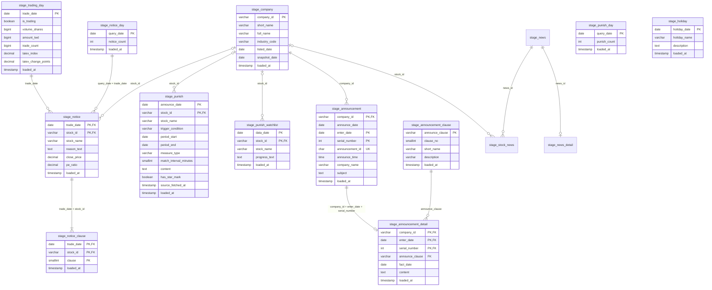

# 資料表說明

資料庫分四層：

| 層 | 表名開頭 | 內容 | 建表 SQL |
|---|---|---|---|
| raw | `raw_` | API 回應原文 | [`schema/raw.sql`](../schema/raw.sql) |
| stage | `stage_` | raw 整理後的官方資料，不做業務判斷 | [`schema/stage.sql`](../schema/stage.sql) |
| app | `app_` | 規則引擎算出的結果，給網頁讀 | [`schema/app.sql`](../schema/app.sql) |
| app（VIEW） | `app_` | 網頁需要的 stage（和 ai）欄位，網頁只讀 `app_*` | [`schema/view.sql`](../schema/view.sql) |
| ai | `ai_` | AI 項目的結果、LLM 呼叫紀錄 | [`schema/ai.sql`](../schema/ai.sql) |

每天只處理當天的資料；每張表另有 `loaded_at`（寫入時間）。時間欄位（`fetched_at`、`loaded_at`）都是 TIMESTAMP（不含時區）、台灣時間。期間為 2026/11/14 的資料。

## raw 層

一個來源一張表，欄位都一樣；一列＝抓一次的 API 回應。

| 欄位 | 型別 | 說明 |
|---|---|---|
| raw_key | VARCHAR(30) | 主鍵之一，例如 `20261113`、`202611`、`2026`、`1303_202611` |
| fetched_at | TIMESTAMP(6) | 主鍵之一；抓取時間（台灣時間） |
| http_status | SMALLINT | HTTP 狀態碼 |
| ok | BOOLEAN | 成功且內容檢查通過；transform 只讀 ok 的列 |
| problem | TEXT | 失敗原因；成功為 NULL |
| url | TEXT | 請求網址（含查詢參數） |
| request_body | TEXT | POST 的參數（JSON 字串）；GET 為 NULL |
| body | TEXT | API 回應原文（JSON 字串） |

- 例外：`raw_news_detail`（新聞網頁）的 `body` 不是回應原文，是 `crawl_news_detail` 組的 JSON（`<head>`、轉址後的網址、全文有幾個字），全文不存；`raw_key` 是 32 個字的 news_id；沒打的轉址連結 `http_status` 為 NULL。

| 表 | raw_key | 整理成 |
|---|---|---|
| `raw_notice` | 查詢日期 | `stage_notice`、`stage_notice_clause`、`stage_notice_day` |
| `raw_punish` | 查詢日期 | `stage_punish`、`stage_punish_day` |
| `raw_punish_watchlist` | 名單上的資料日期 | `stage_punish_watchlist` |
| `raw_market_daily` | 月份 | `stage_trading_day` |
| `raw_stock_price` | 查詢日期 | `stage_stock_price` |
| `raw_holiday` | 西元年 | `stage_holiday` |
| `raw_company` | 抓取日期 | `stage_company` |
| `raw_announcement` | 公司代號_月份 | `stage_announcement` |
| `raw_announcement_detail` | 公司代號_輸入日期_序號 | `stage_announcement_detail` |
| `raw_stock_news` | 證券代號_日期 | `stage_news`、`stage_stock_news` |
| `raw_news_detail` | news_id（連結的 md5） | `stage_news_detail`（只存 `<head>`，全文不存） |

- 只新增、不修改：主鍵（raw_key, fetched_at），同一個 raw_key 每抓一次多一列，成功、失敗都留。transform 只讀每個 raw_key 最新一份成功的，所以失敗不會蓋掉之前成功的。

## stage 層

每張表（固定資料的 `stage_announcement_clause` 除外）最後都有兩欄：`loaded_at`（寫入時間）、`source_fetched_at`（TIMESTAMP(6)，
這列來自哪次抓取，也就是 raw 的 `fetched_at`）。寫入時用主鍵更新，只讓 `source_fetched_at` 比較新（或一樣新）的覆蓋：好幾個 worker、好幾輪同時整理，誰先寫完結果都一樣。

| 表 | 一列是 | 主鍵 | 期間 |
|---|---|---|---|
| `stage_notice` | 某天某檔的注意股 | trade_date, stock_id | 05/04–11/20 |
| `stage_notice_clause` | 某天某檔的一個款次 | trade_date, stock_id, clause | 05/04–11/20 |
| `stage_notice_day` | 一天的注意股查過了（幾檔；休市日也有一列） | query_date | 05/01–11/20 |
| `stage_punish` | 一則處置公告 | announce_date, stock_id | 04/17–11/20（含 05/01 仍在處置中的） |
| `stage_punish_day` | 一天的處置股抓到了（幾則） | query_date | 05/01–11/20 |
| `stage_punish_watchlist` | 官方注意累計名單的一檔 | data_date, stock_id | 11/09–11/20（API 只有最新一天，11/09 開始每天抓） |
| `stage_trading_day` | 一天（有沒有交易） | trade_date | 05/01–11/20 |
| `stage_stock_price` | 某天某檔的收盤行情（那天有成交的） | trade_date, stock_id | 05/04–11/20 |
| `stage_holiday` | 官方開休市日期的一天 | holiday_date | 2026、2027 全年 |
| `stage_company` | 一家上市公司 | company_id | 11/20 快照 |
| `stage_announcement` | 一則重大訊息 | company_id, enter_date, serial_number | 04/01–11/20（發言日期；7,391 則） |
| `stage_announcement_detail` | 一則重大訊息的全文 | company_id, enter_date, serial_number | 同上（輸入日期最早 03/17） |
| `stage_announcement_clause` | 一個符合條款（固定資料，51 列） | announce_clause | — |
| `stage_news` | 一則新聞：標題、連結、媒體、時間（FinMind；好幾檔都有的新聞也只有一列） | news_id | 11/20 起（每天被關注的上市公司） |
| `stage_stock_news` | 哪檔有哪則新聞（FinMind；同一則新聞好幾檔就好幾列） | stock_id, news_id | 同上 |
| `stage_news_detail` | 一則新聞的網頁：導言、全文有幾個字（新聞網站本身；全文不存，抓不到的沒有列） | news_id | 同上 |

## 關聯圖



- PK＝主鍵，FK＝關聯到另一張表的欄位；關聯是邏輯上的，資料庫沒設 FK。

## 欄位

「API 欄位」是資料列裡的欄位名稱；證交所的資料列是陣列，名稱在 `fields`（觀測站在 `result.titles`）。依欄名取值：官方多加欄位、調整順序都不影響，用到的欄位不見了 transform 才會報錯。轉換規則在 `transform/transformer.py`。

### stage_notice　注意股

- 來源：`raw_notice`（證交所 `GET /rwd/zh/announcement/notice` → `data`）
- 沒用到：編號、累計次數（不是個股的累計次數）

| 欄位 | 型別 | API 欄位 | 轉換／說明 |
|---|---|---|---|
| trade_date | DATE | 日期 | 民國 → 西元 |
| stock_id | VARCHAR(10) | 證券代號 | — |
| stock_name | VARCHAR(50) | 證券名稱 | — |
| reason_text | TEXT | 注意交易資訊 | 去 HTML |
| close_price | DECIMAL(12,4) | 收盤價 | 文字 → 數字 |
| pe_ratio | DECIMAL(12,4) | 本益比 | 文字 → 數字；沒有為 NULL |

### stage_notice_clause　注意款次

- 來源：`raw_notice` 的注意交易資訊（和 `stage_notice` 一起產生）

| 欄位 | 型別 | API 欄位 | 轉換／說明 |
|---|---|---|---|
| trade_date | DATE | 日期 | 民國 → 西元 |
| stock_id | VARCHAR(10) | 證券代號 | — |
| clause | SMALLINT | 注意交易資訊 | 每個「第X款」一列，1～14 |

- 第 1–8 款會累計，第 9–14 款不累計。找不到款次時 transform 會報錯。

### stage_notice_day　注意股（每個查詢日一列）

- 來源：`raw_notice`（和 `stage_notice` 一起產生）

| 欄位 | 型別 | 說明 |
|---|---|---|
| query_date | DATE | 查詢的那天（休市日也會查，所以不一定是交易日） |
| notice_count | INT | 那天幾檔被列注意；0＝沒人被列（休市日一定是 0） |

- 用來分辨「那天沒人被列」（有這列，0 檔）和「還沒抓到」（沒有這列）。analyze 算之前會檢查。
- 跟 `stage_punish_day` 一樣用 `query_date`：兩張都是「這天查過了」的標記表，日期是查詢日，不是交易日。

### stage_punish　處置股

- 來源：`raw_punish`（證交所 `GET /rwd/zh/announcement/punish`，當天～當天＋14 天 → `data`）
- 沒用到：編號、累計、備註

| 欄位 | 型別 | API 欄位 | 轉換／說明 |
|---|---|---|---|
| announce_date | DATE | 公布日期 | 民國 → 西元（去掉 *） |
| stock_id | VARCHAR(10) | 證券代號 | — |
| stock_name | VARCHAR(50) | 證券名稱 | — |
| trigger_condition | VARCHAR(50) | 處置條件 | 例如「連續三次」 |
| period_start | DATE | 處置起迄時間 | `～` 前半，民國 → 西元 |
| period_end | DATE | 處置起迄時間 | `～` 後半，民國 → 西元 |
| measure_type | VARCHAR(20) | 處置措施 | 第一次／第二次處置 |
| match_interval_minutes | SMALLINT | 處置內容 | 抓「約每X分鐘」；沒寫為 NULL |
| content | TEXT | 處置內容 | — |
| has_star_mark | BOOLEAN | 公布日期 | 是否以 * 開頭（意義未確認） |
| source_fetched_at | TIMESTAMP(6) | （raw 的 fetched_at） | 這列來自哪次抓取 |

- 同一則公告每天都會查到，寫入時用主鍵更新，留最後抓到的（比 `source_fetched_at`）；同一批裡重複的，後面的蓋掉前面的。
- API 篩的是處置期間，所以公布日期會比抓取期間早；回測要往前多抓幾週。

### stage_punish_day　處置股（每天一列）

- 來源：`raw_punish`（和 `stage_punish` 一起產生）

| 欄位 | 型別 | 說明 |
|---|---|---|
| query_date | DATE | 查詢的那天 |
| punish_count | INT | 查到幾則處置公告（那天起 14 天內處置中的）；0＝沒有 |

- 用來分辨「沒有處置」和「還沒抓到」。analyze 算之前會檢查。

### stage_punish_watchlist　注意累計名單

- 來源：`raw_punish_watchlist`（證交所 `GET /rwd/zh/announcement/notetrans` → `data`）
- 沒用到：編號

| 欄位 | 型別 | API 欄位 | 轉換／說明 |
|---|---|---|---|
| data_date | DATE | `title` | 取標題裡的日期，民國 → 西元 |
| stock_id | VARCHAR(10) | 證券代號 | — |
| stock_name | VARCHAR(50) | 證券名稱 | — |
| progress_text | TEXT | 近期達本公司「公布注意交易資訊」標準之情形 | `<br>` → 換行，去 HTML |

- 官方答案，用來驗證規則引擎的「只差一次」。

### stage_trading_day　交易日曆

- 來源：`raw_market_daily`（證交所 `GET /rwd/zh/afterTrading/FMTQIK`，一次一個月 → `data`）
- 每天一列：從那個月 1 號寫到這份資料涵蓋到的那天。

| 欄位 | 型別 | API 欄位 | 轉換／說明 |
|---|---|---|---|
| trade_date | DATE | 日期 | 民國 → 西元 |
| is_trading | BOOLEAN | — | 資料裡有這天＝true；涵蓋範圍內但沒有＝false（週末、休市、颱風假） |
| volume_shares | BIGINT | 成交股數 | 文字 → 數字 |
| amount_twd | BIGINT | 成交金額 | 文字 → 數字（元） |
| trade_count | BIGINT | 成交筆數 | 文字 → 數字 |
| taiex_index | DECIMAL(12,2) | 發行量加權股價指數 | 文字 → 數字 |
| taiex_change_points | DECIMAL(12,2) | 漲跌點數 | 文字 → 數字 |

- 以實際成交為準，臨時休市也正確；「連續營業日」用 `is_trading` 為 true 的列。
- 涵蓋到哪天看抓取時間：15:00（收盤資料公布）以後抓的含當天，之前抓的只到前一天。之後的日子沒有列＝還不知道，analyze 不會算。
- 沒交易的日子成交欄位都是 NULL。

### stage_stock_price　每日收盤行情

- 來源：`raw_stock_price`（證交所 `GET /rwd/zh/afterTrading/MI_INDEX?type=ALLBUT0999`，一次一天 → `tables` 裡有「證券代號」「收盤價」欄位的那張）
- 全部上市股票、ETF，不含權證、牛熊證。那天沒成交（收盤價「--」）的不放。

| 欄位 | 型別 | API 欄位 | 轉換／說明 |
|---|---|---|---|
| trade_date | DATE | — | 回應的列沒有日期，用查詢的那天 |
| stock_id | VARCHAR(10) | 證券代號 | 去空白 |
| stock_name | VARCHAR(50) | 證券名稱 | 去空白 |
| open_price | DECIMAL(10,2) | 開盤價 | 文字 → 數字 |
| high_price | DECIMAL(10,2) | 最高價 | 文字 → 數字 |
| low_price | DECIMAL(10,2) | 最低價 | 文字 → 數字 |
| close_price | DECIMAL(10,2) | 收盤價 | 文字 → 數字 |
| price_change | DECIMAL(10,2) | 漲跌(+/-)、漲跌價差 | 符號（HTML，例如 `<p style= color:red>+</p>`）＋價差 → 帶正負號的數字；平盤 0，不比價（X）NULL。和參考價比，除權息日已經調整 |
| volume_shares | BIGINT | 成交股數 | 文字 → 數字 |

- 卡片上的收盤價、漲跌幅從這裡拿（`app_card.close_price`、`change_pct`）；注意股公告也有收盤價，但只有當天被列的才有。

### stage_holiday　開休市日期

- 來源：`raw_holiday`（證交所 `GET /rwd/zh/holidaySchedule/holidaySchedule`，`date`＝那年 1 月 1 日 → `data`）

| 欄位 | 型別 | API 欄位 | 轉換／說明 |
|---|---|---|---|
| holiday_date | DATE | 日期 | 本來就是西元 |
| holiday_name | VARCHAR(100) | 名稱 | — |
| description | TEXT | 說明 | — |

- 也含「開始交易日」這類有交易的日子；不含臨時休市。
- 年份要用 `date` 指定，`queryYear` 會被忽略。

### stage_company　上市公司

- 來源：`raw_company`（證交所 OpenAPI `GET /v1/opendata/t187ap03_L` → 整個清單），只讀最新一份，依 company_id 更新（新的新增；下市的公司留著，snapshot_date 停在最後出現那天）
- 沒用到：其餘 28 個欄位

| 欄位 | 型別 | API 欄位 | 轉換／說明 |
|---|---|---|---|
| company_id | VARCHAR(10) | 公司代號 | — |
| short_name | VARCHAR(50) | 公司簡稱 | — |
| full_name | VARCHAR(200) | 公司名稱 | — |
| industry_code | VARCHAR(10) | 產業別 | — |
| listed_date | DATE | 上市日期 | 本來就是西元 |
| snapshot_date | DATE | `raw_key` | raw 的抓取日期 |

- 只有現行上市公司。
- 含少數 DR（台灣存託憑證：外國公司在台上市的憑證，代號 91 開頭 6 碼，例如 `911868 同方友友-DR`）。

### stage_announcement　重大訊息

- 來源：`raw_announcement`（觀測站 `POST /mops/api/t05st01`，一家公司一個月 → `result.data`）
- `code` 406＝那個月沒有公告

| 欄位 | 型別 | API 欄位 | 轉換／說明 |
|---|---|---|---|
| company_id | VARCHAR(10) | 公司代號 | — |
| announce_date | DATE | 發言日期 | 民國 → 西元 |
| enter_date | DATE | 詳細資料 的 `parameters.enterDate` | `1151102` → 日期；輸入日期 |
| serial_number | INT | 詳細資料 的 `parameters.serialNumber` | 輸入日期當天第幾則 |
| announcement_id | CHAR(32) | （主鍵三欄） | 公告代號：md5(`公司_輸入日期_序號`)，例如 md5(`9908_20261102_1`)（`common/hash_utils.py` 的 `key_md5`）。主鍵三欄合成一欄，重建也不變；`ai_announcement_label`、API 用它對應，表上的 CHECK 確認和 SQL 算的一樣 |
| announce_time | TIME | 發言時間 | 判斷收盤前／後 |
| company_name | VARCHAR(50) | 公司名稱 | — |
| subject | TEXT | 主旨 | 接回被換行切斷的字 |

- 只有被列注意或處置的公司，查當月和上個月。
- 序號依輸入日期編，同一天發言的公告可能同號，所以主鍵用 enter_date。主鍵三欄另外合成一欄 `announcement_id`，給其他表、API 對應。

### stage_announcement_detail　重大訊息全文

- 來源：`raw_announcement_detail`（觀測站 `POST /mops/api/t05st01_detail`，一則公告 → `result.data`）
- 主鍵和 `stage_announcement` 相同，一則公告一列；主鍵從 raw_key（`9908_20261102_1`）取，回應裡沒有輸入日期。
- 發言人姓名、職稱、電話是個資，只留在 raw，不放進 stage。
- 存託憑證（DR，`t59sb01_detail`）格式不同：沒有「說明」，`content` 取「發生依外國發行人…應即申報之重大情事」＋「其他」；`announce_clause` 是另一份規定的 `第五條第N款`，對不到 `stage_announcement_clause`（`clause_name` 為 NULL）。

| 欄位 | 型別 | API 欄位 | 轉換／說明 |
|---|---|---|---|
| company_id | VARCHAR(10) | （raw_key） | — |
| enter_date | DATE | （raw_key） | `20261102` → 日期 |
| serial_number | INT | （raw_key） | 輸入日期當天第幾則 |
| announcement_id | CHAR(32) | （raw_key） | 公告代號，和 `stage_announcement.announcement_id` 一樣（＝ raw_key 的 md5） |
| announce_clause | VARCHAR(20) | 符合條款 | 例如 `第31款`（觀測站的公告分類；和注意股的款次 `stage_notice_clause.clause` 是不同東西） |
| fact_date | DATE | 事實發生日 | 民國 → 西元 |
| content | TEXT | 說明 | 全文；換行統一成 `\n` |

### stage_announcement_clause　重大訊息條款對照表

- 固定資料，不用爬：寫在 `schema/stage.sql`，每次建表（transform 開始時）一併寫入／更新。條文修正時改那裡。
- 來源：證交所《對有價證券上市公司重大訊息之查證暨公開處理程序》第 4 條第 1 項（115.09.30 版），共 51 款（第 39 款已刪除）。
- `short_name`、`description` 是整理後的摘要，不是條文原文。第 51 款是概括條款（其他重大事項），被列注意後公司被要求公布的財務業務資訊也是這款。

| 欄位 | 型別 | 說明 |
|---|---|---|
| announce_clause | VARCHAR(20) | 主鍵，例如 `第31款`（和 `stage_announcement_detail.announce_clause` 一樣） |
| clause_no | SMALLINT | 款次數字，排序用 |
| short_name | VARCHAR(20) | 簡短名稱（卡片標籤），例如 `財務報告`、`法人說明會`、`其他重大事項` |
| description | VARCHAR(200) | 條文摘要 |

### stage_news　新聞

- 來源：`raw_stock_news`（FinMind `GET /api/v4/data?dataset=TaiwanStockNews&data_id=<代號>&start_date=<日期>`，一檔一天）
- 只抓當天被關注的上市公司（注意股、處置股，和重大訊息同一批），每檔那天和往前 7 天，由 `crawler/producer.py` 抓。
- 一則新聞一列：FinMind 一檔一檔查，好幾檔都有的新聞，時間、標題以最新一次抓到的為準。只有標題、連結、媒體、時間，不存內文（著作權）。

| 欄位 | 型別 | API 欄位 | 轉換／說明 |
|---|---|---|---|
| news_id | CHAR(32) | link | 主鍵；連結（去掉前後空白）的 md5（`common/hash_utils.py` 的 `url_md5`）。連結太長（最長好幾百字）不好當主鍵；表上的 CHECK 確認等於 SQL 的 `md5(link)` |
| link | TEXT | link | Google 新聞的轉址連結可能好幾百字 |
| news_time | TIMESTAMP(0) | date | FinMind 給 UTC，轉成台灣時間；所以查 11/20 拿到的是台灣時間 11/20 08:00～11/21 08:00 |
| news_date | DATE | date | news_time 的日期 |
| publisher | VARCHAR(50) | source | 發布的媒體，例如 自由時報、CMoney（FinMind 叫 source，但它是媒體，不是資料來源） |
| title | TEXT | title | 去掉結尾的「 - 媒體」 |

- 同一份回應裡同一個連結出現兩次（不同時間或標題）：只留最早的一則。

### stage_stock_news　哪檔有哪則新聞

- 來源：`raw_stock_news`（FinMind），和 `stage_news` 同一個任務整理。新聞本身在 `stage_news`，用 `news_id` 對應。

| 欄位 | 型別 | API 欄位 | 轉換／說明 |
|---|---|---|---|
| stock_id | VARCHAR(10) | stock_id | |
| news_id | CHAR(32) | link | `stage_news.news_id` |

### stage_news_detail　新聞網頁

- 來源：`raw_news_detail`（新聞網站本身：`crawl_news_detail` 打開每則新聞的連結）。raw 只存 `<head>`（標題、meta 摘要）：`<body>` 就是新聞全文，不存進資料庫（著作權）；全文只在記憶體裡抽，這裡只記有幾個字。
- 抓不到的（被擋 4xx、不是網頁、Google 轉址）沒有列，原因在 `raw_news_detail.problem`。

| 欄位 | 型別 | raw 欄位 | 轉換／說明 |
|---|---|---|---|
| news_id | CHAR(32) | （raw_key） | `stage_news.news_id` |
| final_url | TEXT | final_url | 轉址後實際打開的網址 |
| lead | TEXT | head | 導言：`<head>` 裡的 meta 摘要（og:description、description），新聞網站自己寫的一兩句。有些網站每則都放同一句網站介紹（例如富聯網），`app_stock_news` 會排除 |
| text_chars | INT | text_chars | 抽出來的全文有幾個字（全文本身不存）；抽不到為 NULL |

## app 層

規則引擎（`analyze/engine.py`）的結果。只有最近 30 個營業日被列過注意的股票才有一列。

每個交易日的結果都留著；重跑某天只換掉那天的列，`process_date` 記最後一次是哪天算的。

### app_progress　離處置還差幾次

主鍵：trade_date, stock_id

| 欄位 | 型別 | 說明 |
|---|---|---|
| trade_date | DATE | 交易日 |
| stock_id | VARCHAR(10) | 證券代號 |
| count_start | DATE | 從哪天開始算（上次處置公告的隔一個營業日） |
| streak3 | SMALLINT | 連續幾天被列第 1 款（門檻 3） |
| streak5 | SMALLINT | 連續幾天被列第 1～8 款（門檻 5） |
| in10 | SMALLINT | 最近 10 個營業日內幾天被列第 1～8 款（門檻 6） |
| in30 | SMALLINT | 最近 30 個營業日內幾天被列第 1～8 款（門檻 12） |
| streak3_left | SMALLINT | 連 3 日還差幾次（1＝只差一次） |
| streak5_left | SMALLINT | 連 5 日還差幾次 |
| in10_left | SMALLINT | 10 日 6 次還差幾次（已算進會滑出窗口的日子） |
| in30_left | SMALLINT | 30 日 12 次還差幾次（已算進會滑出窗口的日子） |
| steps_left | SMALLINT | 還差幾次：四條裡最少的（卡片上的大字「差 N 次」） |
| closest_path | VARCHAR(10) | 最快達標的那條（同分依 streak3、streak5、in10、in30 的順序） |
| punished_by | VARCHAR(40) | 今天達到哪幾條，例如 `streak3`；沒有為 NULL |
| has_full_history | BOOLEAN | 前面有沒有 30 個營業日的資料；沒有時 in30 可能偏少 |
| period_start | DATE | 處置起日（來自 `stage_punish`）；公布當天到出關當天都有值，其他為 NULL，下兩欄同 |
| period_end | DATE | 處置迄日 |
| resume_date | DATE | 出關：迄日的下一個營業日，恢復正常交易 |
| next_listed_date | DATE | 只差一次時：假設再被列注意的那天（下一個營業日）；其他為 NULL，下同 |
| next_punish_round | SMALLINT | 那次會是第幾次處置（最近 30 個營業日內已有處置公告 → 2） |
| next_period_start | DATE | 那次的處置起日（再列那天的下一個營業日） |
| next_period_end | DATE | 那次的處置迄日（5 個營業日；連 3／連 5 日含第 13 款 7 個；8/10 前舊制 10／12 個） |
| next_resume_date | DATE | 那次的出關日 |
| process_date | DATE | 哪一天算的（台灣日期；重跑會更新） |

- `next_*` 是推算的「若再被列注意就處置」：回測用，網頁不顯示（網頁只放已發生、已公布的事）。
- 還差幾次＝假設之後每個營業日都被列注意，再幾天會達標。例：10 日內被列 5 天，但最舊那天明天就滑出窗口 → `in10_left`＝2，不是 6−5＝1。
- 今天達標（`punished_by` 有值）時，`*_left`、`steps_left` 都是 NULL：隔天重新算。
- 未來的營業日依開休市日期推算（週一～五、扣掉休市日）；臨時休市要隔天重算才會反映。
- 第 13 款若在再列的那天才出現，會延長為 7 天，事前算不出來（回測 129 筆中 5 筆是這種）。
- 總覽的分頁（分區，每檔只在一區，加起來＝全部；依序判斷）：即將處置＝`punished_by` 有值，或 `period_start` 有值且 `> trade_date`（處置已公布、還沒開始）；處置中＝`period_start ≤ trade_date ≤ period_end`，其中 `period_end = trade_date` 的放明日出關；聽牌＝`steps_left = 1`；其他＝剩下的。
- 總覽的「只看」篩選（一檔可以同時符合好幾個）：「11/20 注意股」（日期是資料的那天）＝`app_card.is_listed_today`；「11/20 出關」＝`resume_date = trade_date`。
- 總覽只放 `app_card.is_company` 為 true 的（不放權證、ETF），也不放近 30 個營業日沒有會累計紀錄、今天沒被列、沒有處置的股票（四條路徑都是 0）。

### app_progress_date　計入的日期

主鍵：trade_date, stock_id, path, counted_date

| 欄位 | 型別 | 說明 |
|---|---|---|
| trade_date | DATE | 哪一天的進度 |
| stock_id | VARCHAR(10) | 證券代號 |
| path | VARCHAR(10) | `streak3`／`streak5`／`in10`／`in30` |
| counted_date | DATE | 這一條計入的一天 |
| process_date | DATE | 哪一天算的（台灣日期；重跑會更新） |

### job_run　任務歷史

- 每個任務每跑一次一列（成功、要重試、失敗都寫），本機依序執行和 Celery worker 都寫；只新增、不修改，永久保留。
- 由 `common/runner.py` 的 `record()` 寫入（worker 上由 `common/worker.py` 的 `Job` 呼叫）；寫不進去只印警告，不影響任務。

| 欄位 | 型別 | 說明 |
|---|---|---|
| run_id | BIGINT | 流水號（主鍵） |
| task | VARCHAR(80) | 任務名稱，例如 `crawler.task.crawl_notice` |
| args | JSONB | 參數，例如 `{"date_yyyymmdd": "20261120"}` |
| status | VARCHAR(10) | `success`／`retry`（暫時性失敗、等一下重做）／`failure` |
| result | TEXT | 成功時的一行結果，例如 `raw_notice/20261120` |
| error | TEXT | 失敗時的錯誤（類型: 訊息） |
| attempt | SMALLINT | 第幾次嘗試（1＝第一次） |
| mode | VARCHAR(10) | `celery`＝worker 上跑；`local`＝本機依序執行 |
| worker | VARCHAR(80) | 哪個 worker，例如 `crawl_twse@tw_stock`；本機為 NULL |
| started_at、finished_at | TIMESTAMP(3) | 開始、結束（台灣時間） |
| seconds | DECIMAL(10,3) | 花了幾秒 |

```sql
-- 今天失敗的任務
SELECT task, args, error FROM tw_stock.job_run WHERE status = 'failure' AND started_at >= CURRENT_DATE;
-- 每個任務跑幾次、平均幾秒、失敗幾次
SELECT task, COUNT(*), ROUND(AVG(seconds), 2), COUNT(*) FILTER (WHERE status = 'failure') FROM tw_stock.job_run GROUP BY task;
```

### VIEW（給網頁讀）

VIEW 是存起來的查詢，不複製資料；網頁查的時候資料庫才去讀 stage（和 ai）表。網頁的 SQL 只寫 `app_*`，stage 欄位改了只要改 VIEW。

| VIEW | 給哪個畫面 | 內容 |
|---|---|---|
| `app_card` | 卡片牆、個股卡片上半部 | `app_progress` 每一列，加上 `stock_name`、`is_listed_today`、`is_company`（上市公司；卡片牆只放這些，不放權證、ETF）、`close_price`（`stage_stock_price` 當天的收盤；還沒抓到就用注意股公告上的）、`price_change`、`change_pct`（漲跌、漲跌幅 %＝漲跌 ÷（收盤－漲跌）× 100，只有收盤行情有）、`reason_text`、`clauses`（今天被列第幾款，例如 `1,2`）、`is_counted_today`、處置中那次的 `measure_type`／`trigger_condition`／`match_interval_minutes`（和 `app_punish_history` 同名）、`announcement_count`（近 30 個營業日公告則數）、`ai_summary`、`ai_summary_news_ids`（卡片 AI 摘要最新一版、通過檢查的，和用到的新聞） |
| `app_trading_day` | 注意紀錄格子、公告和處置紀錄的起日 | `stage_trading_day` 裡有交易的日子（`trade_date`） |
| `app_notice_history` | 注意紀錄格子 | 每檔每個被列注意的交易日：`clauses`、`is_counted`（true＝累計）、`reason_text`（那天被列的原因全文）。沒被列的日子沒有列；早於 `count_start` 的是「已計入前次處置」 |
| `app_punish_history` | 處置紀錄 | `stage_punish` 的欄位 |
| `app_stock_news` | 新聞資訊（網站的新聞列表；新聞 RAG 轉向量的文字也從這裡讀） | `stage_stock_news` 每一列，用 `news_id` JOIN `stage_news` 帶出標題、媒體（`publisher`）、時間、連結，LEFT JOIN `stage_news_detail` 帶出 `lead`（導言）；3 則以上新聞共用的同一句導言（網站介紹、個股概覽頁）當成沒有，為 NULL。`ai_summary`：`ai_news_summary` 最新一版、通過檢查的摘要。`story_id`：同一件事（`ai_news_story`；還沒歸類就是自己的 `news_id`），API 的新聞列表一件事只列最早的那則；標題有「股市爆料同學會」的論壇貼文不列 |
| `app_announcement` | 公開資訊 | `stage_announcement`（含 `announcement_id`），加上 `is_during_session`（14:30 前＝交易時段內）、`is_correction`（更正）、`is_explanation`（說明、澄清：類型是澄清／回應媒體）——用公告分類（`ai_announcement_label` 最新一版）的判斷，還沒分類的先用主旨關鍵字；`category`、`has_news`、`is_negative`、`ai_summary`（公告分類的類型、有新消息、壞消息、白話摘要，`summary_ok` 才顯示）；用 `announcement_id` LEFT JOIN `stage_announcement_detail` 帶出 `announce_clause`、`fact_date`、`content`（還沒抓到全文的為 NULL），再 JOIN `stage_announcement_clause` 帶出 `clause_name`（例如 財務報告） |

## ai 層

AI 項目的結果（由 `ai/task.py` 寫入）。和 `app_*` 分開：`app_*` 隨時可以從 stage 免費重算；AI 結果重跑要花錢、同樣的輸入每次答案可能不同，所以拿到就留著。重算 stage、app（`run_rebuild.bat`）不碰 `ai_*` 表。

### ai_announcement_label　公告分類

- 每則重大訊息每個 prompt 版本一列；同一版已經有就不再問 LLM。改了 prompt 就換版本（`ai/classifier.py` 的 `PROMPT_VERSION`），新版本另外存。
- 由 `classify_announcement` 寫入：模型 `claude-haiku-5-5`（`.env` 的 `AI_CLASSIFY_MODEL`），結構化輸出（JSON schema，`category` 用 enum 限定 13 類）。

| 欄位 | 型別 | 說明 |
|---|---|---|
| announcement_id | CHAR(32) | 主鍵之一；公告代號（`stage_announcement.announcement_id`） |
| prompt_version | VARCHAR(20) | 主鍵之一，例如 `v3` |
| category | VARCHAR(20) | 13 類選一：注意股例行說明、澄清／回應媒體、營收、自結損益、財務報告、訂單、合約、合作、新產品、認證、許可、投資、資產買賣、籌資、股利、庫藏股、人事異動、股東會、董事會、法說會、負面事件、其他 |
| is_correction | BOOLEAN | 更正、補充、修正先前的公告 |
| has_news | BOOLEAN | 有新的資訊；例行、依規定才公布的為否 |
| is_negative | BOOLEAN | 對公司是壞消息（衰退、虧損、訴訟、裁罰、災害、合約取消…）；照事實判斷，不是預測股價。和類型分開判斷（營收衰退仍是「營收、自結損益」）。v3 起才有，舊版為 NULL |
| summary | VARCHAR(100) | 一句白話摘要；程式限制 60 字（`SUMMARY_MAX_CHARS`），超過就帶著上次的回答請 LLM 縮短，只重問一次 |
| reason | TEXT | LLM 給的一句理由（評估、除錯用） |
| summary_ok | BOOLEAN | 摘要通過程式檢查：不超過 60 字、數字都出現在公告裡；否的話網站不顯示摘要（app_announcement.ai_summary 為 NULL） |
| model | VARCHAR(50) | 模型 |
| labeled_at | TIMESTAMP(0) | 分類時間（台灣時間） |

### ai_news_summary　新聞摘要

- 每則新聞每個 prompt 版本一列；同一版已經有就不再問 LLM。改了 prompt 就換版本（`ai/summarizer.py` 的 `PROMPT_VERSION`）。
- 由 `summarize_news` 寫入：模型 `claude-haiku-5-5`（`.env` 的 `AI_SUMMARY_MODEL`）。全文不存進資料庫（著作權），任務當場打開網頁抽全文、交給 LLM，用完就丟；存的只有 LLM 用自己的話寫的摘要。
- 只摘要有抓到網頁（`stage_news_detail` 有列）、全文至少 200 字的新聞；當場打不開（被擋）、全文太短就跳過，不問 LLM。

| 欄位 | 型別 | 說明 |
|---|---|---|
| news_id | CHAR(32) | 主鍵之一；`stage_news.news_id` |
| prompt_version | VARCHAR(20) | 主鍵之一，例如 `v2` |
| summary | VARCHAR(1200) | 摘要；上限依文章長度：文章的三成，最少 80、最多 1200 字（`summarizer.summary_limit`）；跟 LLM 說的是上限的八五成（LLM 常常多寫一點），超過上限就請 LLM 縮短，只重問一次；不是新聞內容（登入頁、網站介紹）的為空字串 |
| summary_ok | BOOLEAN | 摘要通過程式檢查：不是空的、不超過這篇的上限、數字都出現在原文裡；否的話不顯示（`app_stock_news.ai_summary` 為 NULL） |
| model | VARCHAR(50) | 模型 |
| summarized_at | TIMESTAMP(0) | 摘要時間（台灣時間） |

### ai_news_embedding　新聞 RAG 的向量

- 由 `embed_news` 寫入：每天一個任務，把新聞的「標題＋新聞摘要」（沒有摘要用導言，都沒有就只有標題）用本機的 embedding 模型（`.env` 的 `EMBED_MODEL`，預設 `BAAI/bge-m3`）轉成向量。不呼叫 API、不花錢。
- 排在新聞摘要後面；文字的雜湊值（`input_hash`）和上次不一樣（例如摘要後來才寫好）就重轉，換成新的向量。
- 向量放在同一個 PostgreSQL 的 pgvector（`CREATE EXTENSION vector`，寫在 `schema/ai.sql`）：先用 WHERE 篩股票、日期，再在同一句 SQL 用 `<=>`（cosine 距離）排序，不另外架向量資料庫。
- 換模型：新模型的向量另外存一份（主鍵含 `model`），比較完再換；不同模型的向量不能互相比。資料量小，先不建向量索引（全部比一遍就很快）。

| 欄位 | 型別 | 說明 |
|---|---|---|
| news_id | CHAR(32) | 主鍵之一；`stage_news.news_id` |
| model | VARCHAR(80) | 主鍵之一；embedding 模型，例如 `BAAI/bge-m3` |
| embedding | vector(1024) | 標題＋新聞摘要的向量；長度 1，所以 cosine 相似度＝內積，`1 - (a <=> b)` 就是相似度 |
| input_hash | CHAR(32) | 轉成向量的文字的 md5；文字變了就重轉 |
| embedded_at | TIMESTAMP(0) | 轉成向量的時間（台灣時間） |

### ai_news_story　同一件事

- 由 `group_news_stories` 寫入：好幾家媒體報同一件事，歸成一個 story。一則新聞和 3 天內、同一檔股票、比它早的新聞，是同一篇（標題一樣，或一則是另一則的開頭：轉貼時後面加了欄目名稱，例如「…-起漲K線」）或向量相似度 ≥ 0.84（`ai/retriever.py`），就歸到那則的 story；`story_id` 是這件事最早的那則新聞。不呼叫 API。
- 排在 `embed_news` 後面；天和天有先後（後面的歸到前面的），所以整段區間一個任務。重跑會把區間內的新聞重新歸類（每天的資料線會重算最近 8 天）。
- 每則新聞只留一列（主鍵 `news_id`）：換 embedding 模型後重跑就換成新模型的歸類，不會兩個模型混在一起。
- 網站的新聞列表一件事只列最早的那則，後面寫「也有 X、Y 報導」；卡片 AI 摘要挑新聞時，同一件事也只留一則。

| 欄位 | 型別 | 說明 |
|---|---|---|
| news_id | CHAR(32) | 主鍵；`stage_news.news_id` |
| model | VARCHAR(80) | 用哪個 embedding 模型的向量判斷 |
| story_id | CHAR(32) | 這件事最早的那則新聞的 `news_id`；自己就是最早的（或沒有別家報）等於自己的 `news_id` |
| grouped_at | TIMESTAMP(0) | 歸類的時間（台灣時間） |

### ai_card_summary　卡片 AI 摘要

- 由 `summarize_card` 寫入：每天的注意股（今天被列）、聽牌股（還差 1 次），上市公司，一檔一天一列、每個 prompt 版本一列。模型 `claude-haiku-5-5`（`.env` 的 `AI_CARD_MODEL`）。
- 輸入：`app_card` 那天的被列原因、今天的漲跌幅（不含離處置還差幾次、`next_*` 推算）、近 30 天公告和公告分類、新聞 RAG 挑出的新聞（最多 5 則，標題＋新聞摘要）。
- 輸入的雜湊值和前一天一樣就沿用前一天的摘要（`reused`＝是），不呼叫 API。
- 網站讀 `app_card.ai_summary`（最新一版、`summary_ok` 的），用到的新聞照 `news_ids` 從 `app_stock_news` 查標題、連結。

| 欄位 | 型別 | 說明 |
|---|---|---|
| card_id | CHAR(32) | 主鍵之一；卡片代號：md5(`證券代號_日期`)，例如 md5(`2330_20261120`)（`common/hash_utils.py` 的 `key_md5`）；`ai_llm_call.ref_key` 記這個 |
| prompt_version | VARCHAR(20) | 主鍵之一，例如 `v1` |
| stock_id | VARCHAR(10) | 證券代號 |
| card_date | DATE | 卡片的日期（交易日）；和 `stock_id` 一起建索引，`app_card` 用它接 |
| summary | VARCHAR(300) | 2～3 句白話；程式限制 150 字，超過就請 LLM 縮短，只重問一次 |
| news_ids | TEXT[] | 摘要用到的新聞（`stage_news.news_id`）；沒用到新聞是空的 |
| input_hash | CHAR(32) | 輸入的雜湊值（prompt 版本＋整理好的輸入，不含日期本身） |
| summary_ok | BOOLEAN | 摘要通過程式檢查：不超過 150 字、數字都出現在輸入裡、引用的新聞編號是這次給的；否的話不顯示 |
| reused | BOOLEAN | 沿用前一天的摘要（輸入一樣，沒有呼叫 API） |
| model | VARCHAR(50) | 模型 |
| summarized_at | TIMESTAMP(0) | 寫入時間（台灣時間） |

### ai_llm_call　LLM 呼叫紀錄

- 每次呼叫 LLM 一列（`repository.save_llm_call`，和 raw 表的 `save_raw` 一樣：有問題的也記，記完丟 `FetchError`）；只新增。
- API 錯誤（429、5xx、連線失敗）沒有回應，不記在這裡，記在任務歷史 `job_run`。

| 欄位 | 型別 | 說明 |
|---|---|---|
| call_id | BIGINT | 流水號（主鍵） |
| task | VARCHAR(80) | 哪個任務，例如 `classify_announcement`、`summarize_news`、`summarize_card` |
| ref_key | VARCHAR(80) | 處理哪一筆：結果表的代號（公告分類記 `announcement_id`、新聞摘要記 `news_id`、卡片 AI 摘要記 `card_id`），JOIN 結果表一律是 `ref_key ＝ 代號` |
| model、prompt_version | VARCHAR | 模型、prompt 版本 |
| status | VARCHAR(10) | `success`／`failure`（拒答、被截斷、格式不對） |
| stop_reason | VARCHAR(20) | 例如 `end_turn`、`max_tokens`、`refusal` |
| input_tokens、output_tokens | INT | 輸入（不含快取）、輸出（含思考）token |
| cache_read_tokens、cache_write_tokens | INT | 從快取讀、寫進快取的輸入 token |
| cost_usd | DECIMAL(12,6) | 估計花費（美元），用 `ai/client.py` 的 `PRICES` 算 |
| seconds | DECIMAL(10,3) | 花了幾秒 |
| request_id | VARCHAR(80) | API 的 request-id |
| error | TEXT | 失敗原因 |
| called_at | TIMESTAMP(3) | 呼叫時間（台灣時間） |

```sql
-- 每天花多少
SELECT called_at::date, task, COUNT(*), SUM(cost_usd) FROM tw_stock.ai_llm_call GROUP BY 1, 2 ORDER BY 1 DESC;
-- 各類型幾則
SELECT category, COUNT(*), COUNT(*) FILTER (WHERE has_news) FROM tw_stock.ai_announcement_label GROUP BY 1 ORDER BY 2 DESC;
-- 一則公告的分類用了哪幾次呼叫、花多少（摘要太長重問一次就有兩列；失敗的呼叫有紀錄、沒有分類結果）
SELECT l.announcement_id, l.category, c.call_id, c.status, c.input_tokens, c.output_tokens, c.cost_usd, c.called_at
FROM tw_stock.ai_announcement_label l
JOIN tw_stock.ai_llm_call c
  ON c.task = 'classify_announcement' AND c.ref_key = l.announcement_id AND c.prompt_version = l.prompt_version
ORDER BY c.called_at;
-- 新聞摘要：同樣的寫法
SELECT s.news_id, s.summary_ok, c.call_id, c.cost_usd
FROM tw_stock.ai_news_summary s
JOIN tw_stock.ai_llm_call c
  ON c.task = 'summarize_news' AND c.ref_key = s.news_id AND c.prompt_version = s.prompt_version;
```

- 分類、摘要和呼叫紀錄不用外鍵連：一個結果可能來自 1～2 次呼叫（縮短重問），失敗的呼叫沒有結果。`ref_key` 一律記結果表的代號，用上面的 JOIN 對。
